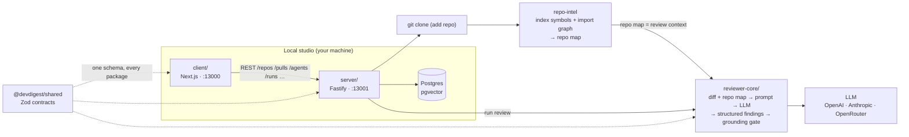

# DevDigest — starter

Local-first AI pull-request review. This is the **starter template**: a
minimal-but-working tool that does exactly one thing end to end — **import a PR
and run an agent review on it**. Every later milestone adds one feature back
(see [_Roadmap_](#roadmap)).

Several standalone packages (no monorepo workspace — each has its own
`package.json` and lockfile; cross-package code is shared through tsconfig path
aliases, not published modules):

| Folder           | Package                     | What it is                                            | Port |
|------------------|-----------------------------|-------------------------------------------------------|------|
| `server/`        | `@devdigest/api`            | Fastify API + Drizzle/Postgres (pgvector)             | 13001 |
| `client/`        | `@devdigest/web`            | Next.js 15 web app (the studio)                       | 13000 |
| `reviewer-core/` | `@devdigest/reviewer-core`  | Pure review engine: diff → prompt → LLM → findings    | —    |
| `e2e/`           | `@devdigest/e2e`            | Deterministic browser e2e (agent-browser)             | —    |
| `server/src/vendor/shared` | `@devdigest/shared` | Zod contracts shared across every package             | —    |
| `docker-compose.yml` | — | Postgres 16 + pgvector (the only containerised service) | 55432 |

`repo-intel` (the codebase indexer that powers the **Indexed** badge and feeds
project context into reviews) lives inside the server at
[`server/src/modules/repo-intel`](server/src/modules/repo-intel). Only
**Postgres** runs in Docker; the API and web app run on the host via `pnpm dev`.

## Architecture



The review flow end to end: **add a repo** → server clones it and `repo-intel`
indexes it (the **Indexed** badge) → **import PRs** from GitHub → open a PR and
**Review** → `reviewer-core` assembles a prompt from the diff + the repo map,
calls the LLM, validates every finding against the diff (the **grounding gate**
drops hallucinated line references), and persists structured findings with a
severity and score. All local; the only outbound calls are to GitHub (PR data)
and the LLM (via OpenRouter).

Each package has its own README with deeper diagrams:
[`client`](client/README.md) (UI route map) ·
[`server`](server/README.md) (API map) ·
[`reviewer-core`](reviewer-core/README.md) (review pipeline) ·
[`e2e`](e2e/README.md).

## What works on day 1

- **Local launch** — one command brings up Postgres (Docker) + API + web.
- **Settings** — store your LLM API key (OpenAI / Anthropic) and GitHub token.
- **Add repository** — paste a repo URL; the server clones and indexes it.
- **Import pull requests** — pull open PRs and their diff, commits, body, and linked issue.
- **View diff** — GitHub-like diff in the browser.
- **Agents** — built-in reviewers (seeded by `server/src/db/seed.ts`); create/edit your own (model + system prompt).
- **Run a review** — single-pass analysis returning structured findings (severity + score), with the grounding gate and repo-map context working from the start.

## Roadmap

These are intentionally **not** in the starter — each milestone adds one back:

| Milestone | You build |
|--------|-----------|
| M1 | Run cost badge · severity filter on findings |
| M2 | Skills in the product · Conventions extractor |
| M3 | Intent layer · Smart Diff |
| M4 | `devdigest-mcp` server · Blast Radius (reads `repo-intel`) |
| M5 | Project Context Folder · Onboarding generator · PR Brief card |
| M6 | Eval pipeline · Secret/Phantom gates · Plan Verifier · Export to CI |
| M7 | Multi-agent review · Run Trace / Live Log · Persistent memory · per-agent stats |
| M8 | Plugin export/import · Agent performance dashboard · weekly digest |

## Prerequisites

- **Node** ≥ 22 · **pnpm** 10 (`npm i -g pnpm@10`; ≥ 11 breaks installs, see [INSIGHTS.md](INSIGHTS.md)) · **Docker** (for Postgres)

## Quick start (from zero)

```sh
./scripts/dev.sh
```

This script:
1. starts Postgres (`docker compose up -d`) and waits until it's healthy,
2. creates `server/.env` and `client/.env` from `.env.example` if missing,
3. installs deps in `server/` and `client/` (only when `node_modules` is absent),
4. applies DB migrations and seeds demo data,
5. launches the API and the web app (ports: table above).

Open the web app in a browser. Press **Ctrl-C** to stop the dev servers —
Postgres keeps running (`docker compose down` to stop it).

Flags: `--no-seed` · `--no-client` · `--db-only` · `--help`.

> Add your keys in `server/.env` (`OPENAI_API_KEY` / `ANTHROPIC_API_KEY`,
> `GITHUB_TOKEN`) or via the Settings UI at runtime.

## Manual steps (what the script does)

```sh
docker compose up -d                                   # Postgres + pgvector

cd server && pnpm install
pnpm db:migrate          # apply migrations (NOT run automatically on boot)
pnpm db:seed             # idempotent demo data (optional)
pnpm dev                 # API

cd ../client && pnpm install && pnpm dev               # web app
```

## Useful scripts

`server/`: `dev` · `build` · `db:migrate` · `db:seed` · `db:generate` · `test` · `typecheck`
`client/`: `dev` · `build` · `start` · `test` · `typecheck`

## Testing & CI

One test suite per package, each gated by its own path-filtered GitHub Actions
workflow. Suite map, test lanes and local commands: **[`TESTING.md`](TESTING.md)**.

## Troubleshooting

- **`relation ... does not exist` / API errors on first run** — migrations weren't
  applied. The server does **not** migrate on boot: run `cd server && pnpm db:migrate`.
- **Postgres port already in use** — another Postgres is running. Stop it, or change the
  host port in `docker-compose.yml`.
- **`vector` type errors** — the pgvector extension is enabled by migration `0000`;
  make sure migrations ran against the Dockerized DB, not a different one.
- **Need a clean DB** — run `./scripts/e2e.sh`, which boots its own throwaway
  Postgres. `docker compose down -v` deletes the `devdigest_pgdata` volume with
  every imported repo and review; do it only when you really mean to wipe it.

## License

[MIT](LICENSE) — fork it, extend it, run it inside your own company. The only
requirement is that the copyright notice travels with the copy.

This starter is meant to be copied: keep it in your own fork and grow it
milestone by milestone into your own working PR-review tool — including using it
for your own projects and at work.
