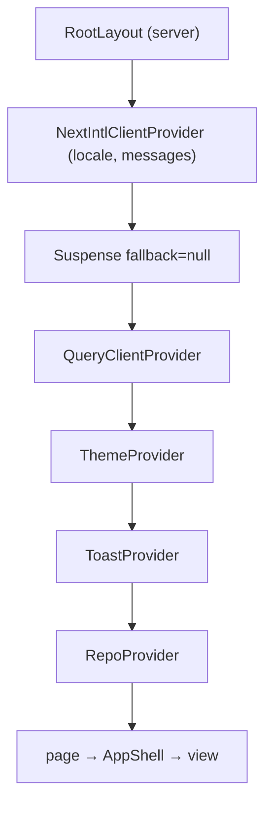
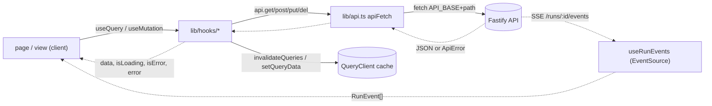

# UI architecture

How `@devdigest/web` is put together and why. Concrete, testable behaviour per route lives in [../specs/pages.md](../specs/pages.md); the HTTP client contract in [../specs/api-client.md](../specs/api-client.md).

## Server vs Client Components

The whole app is effectively client-rendered; the server side is a thin shell.

| Layer | Kind | Evidence |
|-------|------|----------|
| `src/app/layout.tsx` | **Server** (async). Resolves `locale` + `messages` via `next-intl/server`, injects the no-FOUC theme script, mounts `NextIntlClientProvider` > `Suspense` > `Providers`. | `layout.tsx:15-16,21,28-30` |
| `src/app/agents/page.tsx`, `src/app/settings/[section]/page.tsx` | **Server** — no directive, only render a client view. | `agents/page.tsx:5-7`, `settings/[section]/page.tsx:5-7` |
| Every other `page.tsx` (`/`, `/onboarding`, `/repos/:repoId/pulls`, `…/:number`, `/agents/:id`) | **Client** — `"use client"` at the page itself because they read `useParams` / `useSearchParams` / `useRouter` and call query hooks. | first lines of each file |
| `src/lib/providers.tsx`, `repo-context.tsx`, `theme.tsx`, `toast.tsx`, `lib/hooks/*.ts` | **Client** (state, context, TanStack Query). | `"use client"` at top |
| `src/components/**`, `_components/**` | **Client** — every `.tsx` carries the directive except `RunTraceDrawer/_components/atoms.tsx` (pure presentational, imported only by client files, so it is client by inheritance). | `grep -L "use client"` |
| `src/i18n/request.ts` | Server-only (`node:fs`). | `request.ts:3-4` |

Why `'use client'` sits so high:

- Data comes from a **separate Fastify API** (`apiFetch` → `NEXT_PUBLIC_API_BASE`), not from server-side fetches; there is no auth and no server data layer in `client/`. TanStack Query owns caching, polling and invalidation in the browser, so any component that touches a hook must be a Client Component.
- Route state is URL-driven (`?tab`, `?status`, `?trace`), which needs the client-only `useSearchParams`. That is also why the root layout wraps `Providers` in `<Suspense fallback={null}>` (`layout.tsx:29`) — Next requires a Suspense boundary above `useSearchParams` consumers.
- The two Server `page.tsx` files exist only because they have no route-level hooks; the directive lives one level down in `_components/<View>`.

When adding a page: put `"use client"` on the page only if it calls hooks/router itself; otherwise keep the page a Server Component and push the directive into the colocated view.

## Providers tree

Order is defined in `lib/providers.tsx:47-50`. Dependencies that fix the order:

- `RepoProvider` calls `useRepos()` (`repo-context.tsx:26`), so it must sit **inside** `QueryClientProvider`.
- `QueryClient` defaults (`providers.tsx:27-29`): `retry: 1`, `staleTime: 30_000`, `refetchOnWindowFocus: false`. Individual hooks override (e.g. `usePulls` re-enables focus refetch).
- Global error surfacing lives on the query and mutation caches (`providers.tsx:34-43`); which errors toast is pinned in [api-client spec](../specs/api-client.md#how-errors-surface-contract-for-callers).
- `notify` (`toast.tsx:34`) is a module-level bridge: non-React code (the query cache, `useRunEvents`) raises toasts through `activePusher`, which the mounted `ToastProvider` registers. Before the provider mounts, `notify.*` is a silent no-op.
- `ThemeProvider` reads the attribute set by `themeNoFlashScript` (`theme.tsx:44`) so SSR markup (`data-theme="dark"` in `layout.tsx:19`) and the stored `dd-theme` agree before paint.
- `RepoProvider` resolves the active repo: URL `/repos/:id` > `localStorage["dd-repo"]` > first repo (`repo-context.tsx:47-48`).

`AppShell` (`components/app-shell/AppShell.tsx`) is **not** a provider: every page except `/onboarding` renders it itself with its own `crumb`. It wires `@devdigest/ui`'s `AppFrame` to the command palette (`⌘/Ctrl+K`), shortcuts help (`?`) and `g`-then-key navigation (`useGlobalShortcuts.ts`), and builds the `ShellContext` (`useShellContext.ts`).

## Data flow

Rules the code follows:

1. Components never call `fetch`; they use a hook from `src/lib/hooks/*` (barrel `hooks/index.ts` re-exports `core`, `agents`, `reviews`, `trace`, `repo-intel`, `skills`, `conventions`, `intent`).
2. Hooks call `api.*` (`lib/api.ts:65`) which wraps `apiFetch`; failures are normalised to `ApiError` (see [api-client spec](../specs/api-client.md)).
3. Pages consume `{data, isLoading, isError, error, refetch}` and map them to `Skeleton` / `ErrorState` / `EmptyState` from `@devdigest/ui` (details per route in the pages spec).
4. Mutations write back through the cache, not through local state.

### Query keys and invalidation

| Key | Hook (`lib/hooks/…`) | Invalidated / written by |
|-----|------|------|
| `["settings"]` | `useSettings` core:23 | `useUpdateSettings` **sets** it from the response (core:34) |
| `["secrets-status"]` | `useSecretsStatus` core:58 | `useTestConnection` on `res.ok` (core:51) |
| `["provider-models", provider]` | `useProviderModels` agents:84, `staleTime` 5 min | `useTestConnection` on `res.ok` (core:50) |
| `["repos"]` | `useRepos` core:67 | `useAddRepo` (78), `useRefreshRepo` (87), `useDeleteRepo` (97) |
| `["pulls", repoId]` | `usePulls` core:102, polls 60 s | `useRefreshRepo` (88) |
| `["pull", prId]` | `usePullDetail` core:114 | nothing in code |
| `["agents"]`, `["agent", id]` | `useAgents`, `useAgent` | create/update/delete (agents:38,66,77); update also **sets** `["agent", id]` (67); delete **removes** it (78) |
| `["reviews", prId]` | `usePrReviews` reviews:51 | `useDeleteRun` (68), `useDeleteReview` (85), `useRunReview` (133), `useFindingAction` (158, only if `prId` passed) |
| `["pr-runs", prId]` | `usePrRuns` reviews:40, polls 4 s while any run `running` | `useDeleteRun` (67); page `invalidateRunHistory` on run done |
| `["pr-active-runs", prId]` | `usePrActiveRuns` reviews:28, polls 4 s while non-empty | page `invalidateActiveRuns` (after run start / run done) |
| `["pr-comments", prId]` | `usePrComments` reviews:91 | `useCreatePrComment` (113) |
| `["run-trace", runId]` | `useRunTrace` trace:12, `retry: false` | nothing |
| `["pr-intent", prId]` | `usePrIntent` intent:12 (`GET /pulls/:id/intent`, never calls the LLM; `enabled` only with a `prId`) | `useUpdatePrIntent` (intent:25, `PUT`) and `useDerivePrIntent` (intent:33, `POST …/derive`) both `invalidateQueries` on success |
| `["repo-intel-state", repoId]`, `["context", repoId]` | `repo-intel.ts`, `core.ts:123` | hooks exist but **no component uses them** (see Open items) |

Keys are inline string tuples, not a central factory; keep a new key's first element unique and put `repoId`/`prId` second so prefix invalidation works.

### Live run updates (SSE + polling)

Two complementary channels, both keyed on the server's `agent_runs` rows:

- **Polling = source of truth for "is a run in flight".** `usePrActiveRuns` returns `GET /pulls/:id/runs/active`; it refetches every 4 s while the list is non-empty and stops when empty (`reviews.ts:33`). The PR page derives `liveRunIds` / `reviewRunning` from it (`[number]/page.tsx:48-49`), so state survives reload and device change. `usePrRuns` does the same for the timeline (`reviews.ts:45-46`).
- **SSE = the live log only.** `useRunEvents(runIds)` (`reviews.ts:168`) opens one `EventSource` per run at `${API_BASE}/runs/:id/events`, listens on default `message` plus named `info|tool|result|error` events (`reviews.ts:197-199`), accumulates `RunEvent[]`, and sets `running=false` when all streams error/close (`reviews.ts:200-204`). An `error`-kind event also raises a toast (`reviews.ts:189`), because runtime agent failures never pass through the query/mutation error handlers. Non-JSON frames are ignored.
- **Completion handoff.** `RunStatus` renders the stream via `LiveLogStream` and calls `onDone` on the `running` true→false edge (`RunStatus.tsx`, effect on `running`). The page's `onRunDone` then invalidates active-runs and run-history and refetches reviews (`[number]/page.tsx:156-160`) — that is how the final findings appear without reload.
- Note: `RunTraceDrawer` can stream too (`useRunEvents(running ? [runId] : [])`, `RunTraceDrawer.tsx:46`), but the PR page never passes `running`, so the drawer there always shows the persisted trace (`[number]/page.tsx:175-181`).
- CSP `connect-src` allows only `'self'` + `API_BASE` (`next.config.mjs`), which covers both fetch and `EventSource`.

## PR intent panel

`OverviewTab` (`repos/[repoId]/pulls/[number]/_components/OverviewTab/OverviewTab.tsx`) now takes `prId` from the page and renders `IntentPanel` above the PR description. `IntentPanel` (`OverviewTab/_components/IntentPanel/IntentPanel.tsx`) reads `usePrIntent`, and writes with `useUpdatePrIntent` (user edit, `PUT`) and `useDerivePrIntent` ("Derive now" / re-derive, `POST`); mutation errors are toasted by the global `MutationCache.onError`, so the panel adds no local toast and keeps the edit form open when a save fails. States: loading skeleton, `ErrorState` with retry, an empty state with "Derive now" when the API returns `intent: null`, and the filled panel (class and confidence badges, a "user" marker for `source === 'user'`, a "stale" marker when `stale`, a low-confidence notice, summary, rationale, in/out-of-scope lists, sources, the model that derived it). Confidence comes from the server, not the model. Its children live in its own `_components/`:

- `IntentEditForm` — inline editor (class select, summary, scope lists); each control sits inside a real `<label>`, which the e2e flow relies on (see [../../e2e/docs/architecture.md](../../e2e/docs/architecture.md)).
- `IntentSources` — one row per source: kind, ref, status (icon + label), doc version, role, and a hint for `not_found` / `referenced_not_fetched` / `skipped_pull_request`.

Strings are in the `prIntent` messages namespace (`messages/en/prIntent.json`, registered in `src/test/intl.tsx` for tests). The `review_intent` entry of the client-local `FEATURE_MODELS` mirror (`src/lib/feature-models.ts`) is labelled "PR Intent (classifier)" with default `openrouter` / `deepseek/deepseek-v4-flash`, matching `FEATURE_MODELS` in `server/src/vendor/shared/contracts/platform.ts:53-58`; keep the two in sync.

## Internationalisation (next-intl)

- Single locale `en`, **no locale routing** (`i18n/request.ts:14,27-30`); plugin registered in `next.config.mjs` (`createNextIntlPlugin("./src/i18n/request.ts")`).
- Messages: one JSON per namespace in `messages/en/<ns>.json` (20 files). `loadMessages` reads the directory and merges to `{ <ns>: {...} }` (`request.ts:19-25`), so a feature adds a namespace without touching shared code.
- Use `useTranslations("<ns>")` in client code (used across `app/` and `components/`); `getLocale/getMessages` only in the layout.
- Adoption is **partial**: lists, agents list/editor tabs, settings, run status/trace use messages; `/`, `/onboarding`, `/agents/:id` page chrome, the PR detail page and its header/tabs, `OverviewTab`, `DiffTab`, `FindingsTab`, `ReviewRunAccordion` still contain literal English. Several namespaces (`blast`, `brief`, `ci`, `eval`, `memory`, …) are for screens not in this starter. `validation` holds the shared inline form-validation messages (pattern: [specs/pages.md → Forms](../specs/pages.md#forms--inline-validation)). New user-facing strings must go to messages (see [../CLAUDE.md](../CLAUDE.md) conventions).

## Design system (`@devdigest/ui`)

- Vendored at `src/vendor/ui`, aliased in `tsconfig.json` and `vitest.config.ts`. Import rule: [../CLAUDE.md](../CLAUDE.md) Conventions. Catalogue, tokens, theming and the showcase: [../src/vendor/ui/README.md](../src/vendor/ui/README.md).
- `vendor/ui/styles.css` also pulls in Tailwind.
- The shell comes from the DS (`AppFrame`, `Sidebar`, `CommandPalette`, `ShortcutsHelp`); route/shortcut config is `vendor/ui/nav.ts` (`NAV`, `SETTINGS_ITEM`, `SETTINGS_SECTIONS`, `SHORTCUTS`). Adding a nav item or settings section is a change in the vendor package, not in `app/`.

## Component-folder convention

The rule itself is in [../CLAUDE.md](../CLAUDE.md) Conventions. Page-level shared bits (`constants.ts`, `helpers.ts`, `styles.ts` in `repos/[repoId]/pulls/`) sit next to `page.tsx`.

Why:

- **Thin pages.** `page.tsx` handles route params, data hooks and the loading/error/empty switch; markup and logic live in the folder. Very thin pages (`agents`, `settings`) just return the view.
- **Colocation + private folders.** `_components` (underscore) opts the folder out of routing in the App Router, so views sit beside the route that owns them; promote to `src/components/` only when a second route needs it (`app-shell`, `diff-viewer`, `page-shell`, `repo-not-found`, `mermaid-diagram`).
- **Separation of concerns inside a component.** `constants.ts` holds magic values, i18n keys and grid templates; `helpers.ts` stays pure and unit-testable; `styles.ts` uses no CSS modules, so theming stays in the token layer.
- **Barrels.** `index.ts` is the only import surface of a component folder, so internals can be reshuffled.
- Tests sit next to the component (vitest + jsdom + RTL, `fetch` mocked; see [../../TESTING.md](../../TESTING.md)).

Not every folder follows this yet (e.g. `AddRepoView`, `AgentCard`'s delete button and `ReviewRunAccordion` use inline style objects / inline constants instead of `styles.ts` / `constants.ts`); treat the convention as the target for new code.

## Open items (code vs. intent)

- Hooks with no consumer: `useRepoIntelStatus`, `useResyncRepoIntel` (`repo-intel.ts`), `useContextFiles`, `useReindexContext` (`core.ts:123,131`).
- `Showcase.tsx:2` still mentions a `/showcase` route that does not exist.
