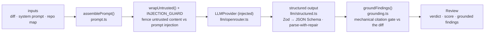

# `@devdigest/reviewer-core` — the review engine

Pure review logic: **diff → prompt → LLM → grounded findings**. No database,
GitHub, or filesystem; the only side effect is an LLM call through an **injected**
`LLMProvider`, which is what makes it mock-testable.

In the starter the **server** (`@devdigest/api`) is its only consumer — for local
reviews in the studio. (The CI runner that runs the same engine in GitHub Actions
is added back in the Export-to-CI milestone, M6.) The server wires it via a tsconfig
path alias (`@devdigest/reviewer-core` → `../reviewer-core/src`) and consumes the
TypeScript **source** directly (tsx in dev, vitest in tests).

## Pipeline

The engine also accepts optional prompt slots that **later milestones** start
feeding: `skills` (M2), `memory` (M7), `specs` (M5). It also has a map-reduce
path and a CI payload helper (`toReviewPayload`, used from M6).

- How the pipeline works and why: [`docs/pipeline.md`](docs/pipeline.md)
- Public API and outcome contract: [`specs/review-contract.md`](specs/review-contract.md)
- Grounding rules: [`specs/grounding.md`](specs/grounding.md)
- Tests: [`../TESTING.md`](../TESTING.md)
