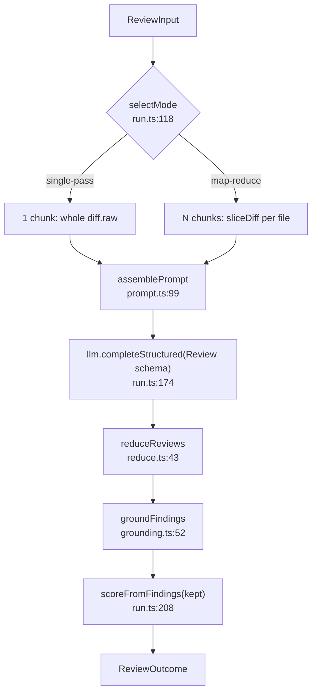

# Review pipeline — how `reviewPullRequest()` works and why

Deeper than the diagram in [../README.md](../README.md). Exact rules live in `specs/`; this file explains the shape and the reasons. All refs are `reviewer-core/` relative.

## Data flow

The loop is sequential (`for … of chunks`, `run.ts:162`), one LLM call per chunk, with `checkCancelled()` before each (`run.ts:164`). Grounding runs **once, after reduce** — never per chunk (`run.ts:197`) — so single-pass and map-reduce share one gate.

## Single-pass vs map-reduce

Selection rules (`selectMode`): review-contract C6–C7. Why `auto` needs both a line threshold and more than one file: one huge file cannot be split by this engine (chunks are per file), so splitting would only add calls. Map-reduce trades more calls for a smaller prompt per call; each chunk gets the full shared context (skills, memory, specs, repo map, callers, PR description, PR intent) and only its own file diff.

Trace nuance: `assembly` in the outcome is the single call's assembly in single-pass, but the whole-diff assembly in map-reduce (`run.ts:142`, `:173`); `chunks` lists the per-call labels (`'all files'` or file paths).

## Prompt assembly and the injection guard

`assemblePrompt` (`prompt.ts:99`) always yields exactly two messages. Design: the **system** message is trusted, the **user** message carries data.

- `INJECTION_GUARD` is the **single shared defence**. It runs on every path (studio and CI) because both go through `reviewPullRequest`. It deliberately does not pattern-match untrusted text, because a denylist catches only one phrasing or language. Instead it tells the model that `<untrusted>` content is data and that intent claims never descope the review.
- Fencing beats escaping. `wrapUntrusted` neutralises a literal closing tag inside the content, so a PR cannot close its own fence.
- Skills and memory stay unwrapped because they are treated as curated. Sanitising community skills is the caller's job.
- **PR intent** (`ReviewInput.intent`, `PromptParts.intent`): the caller (the server's intent module) renders why the PR exists (class, confidence, summary, scope, sources, linked-doc excerpts) into one string. `assemblePrompt` emits it as a `## PR intent` section right after `## PR description`, as a trusted `INTENT_PREAMBLE` line followed by `wrapUntrusted('pr-intent', …)` of the text truncated to `MAX_INTENT_CHARS` (8000). The content is untrusted because it is built from PR, issue and doc text, so it is fenced like the description. An empty or whitespace-only value omits the section and leaves the prompt unchanged. The wrapped block is also stored as `PromptAssembly.intent` (null when absent) for the run trace (`prompt.ts`; `PromptAssembly` in `server/src/vendor/shared/contracts/trace.ts:39`, field `:52`). The preamble and `INJECTION_GUARD` say intent only frames the review and never reduces what is reported.
- Exact layout, order, wrapping and truncation: [../specs/prompt-and-structured-output.md](../specs/prompt-and-structured-output.md) P1–P9.

Prompt text conventions (severity rubric, verdict mapping) are authored outside this package: [../../docs/agent-prompts/README.md](../../docs/agent-prompts/README.md).

## Structured output

The output shape is not described in the prompt. `OpenRouterProvider.completeStructured` (`llm/openrouter.ts:59`) sends the Zod `Review` contract (`server/src/vendor/shared/contracts/findings.ts`) as `response_format: json_schema, strict: true` (`openrouter.ts:74-77`), converted by `toJsonSchema` (`llm/structured.ts:19-22`, OpenAI's `zodResponseFormat`).

Parse-with-repair is a second line of defence. A direct `JSON.parse` comes first because extraction can be fooled by fences or braces *inside* string values, so extraction is only the fallback. On failure the model is re-prompted with the concrete issues instead of failing the run.

There are two distinct retry layers: schema-repair attempts (`req.maxRetries`) and the OpenAI SDK's transport retries for timeouts, 5xx and 429 (`openrouter.ts:54-55`). Exact order, messages and accounting: [../specs/prompt-and-structured-output.md](../specs/prompt-and-structured-output.md) S1–S10.

## Grounding gate, reduce, score

- **Reduce** merges the partial reviews (rules: review-contract C14–C15). The merged model score is later overwritten, so its mean shows only in the `Reduced to…` event (`run.ts:191-194`).
- **Grounding** drops findings that do not cite a real new-side diff line ([../specs/grounding.md](../specs/grounding.md)). Every drop is reported, so the gate never goes silent.
- **Score** is computed *after* grounding so that score, findings list and CI event agree (`run.ts:204-208`; formula: review-contract C9).
- **Verdict is not recomputed** (review-contract C10). Consumers that need a deterministic decision use the CI gate helpers, which ignore the verdict (C17–C18).

## LLMProvider injection boundary

The engine imports no SDK for review logic: `ReviewInput.llm` is the `LLMProvider` interface from `@devdigest/shared`, and only `completeStructured` is called (`run.ts:174`). Everything else (DB, GitHub, FS, memory retrieval, intent, persistence, SSE) is the caller's. Cross-cutting concerns are injected as callbacks: `onEvent` (progress), `checkCancelled` (caller throws its own error type), `sessionId` (forwarded to every call), and, on the provider, `estimateCost`. `OpenRouterProvider` lives here only so the server and a future CI runner share one implementation (session grouping, no-`choices` guard, timeouts, repair loop); `complete()` and `embed()` throw (`openrouter.ts:158-163`).

Cost rules: review-contract C12 and prompt-and-structured-output S9.

## How `server/` consumes it

As TypeScript source, no build: `server/tsconfig.json:24-25` and `server/vitest.config.ts:8` alias `@devdigest/reviewer-core` to `../reviewer-core/src`. Types come the other way: `reviewer-core/tsconfig.json` aliases `@devdigest/shared` to `../server/src/vendor/shared` and `zod` to its own `node_modules`, keeping one zod instance for `instanceof` and schema compatibility. Install consequence: [../CLAUDE.md](../CLAUDE.md) Gotchas.

The server's call sites are `server/src/modules/reviews/run-executor.ts:221` (`reviewPullRequest`, `countBlockers`; it passes `intent` only when the intent module returned one) and `server/src/platform/container.ts:273` (`OpenRouterProvider` with a PriceBook-backed `estimateCost`). What the server does with the outcome: [server/specs/review-flow.md](../../server/specs/review-flow.md).
