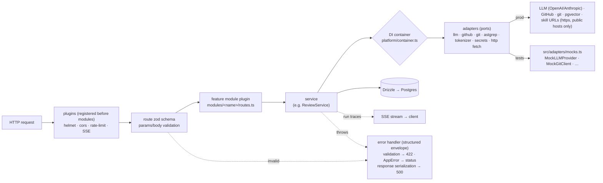
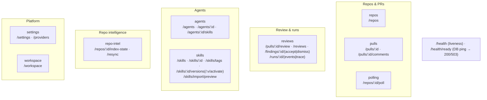

# `@devdigest/api` — the engine (Fastify + Postgres)

The DevDigest backend: imports repos and pull requests, indexes a repo with
`repo-intel`, stores agents, and runs the reviewer (diff → `reviewer-core` →
grounded structured findings). Fastify 5 + Drizzle ORM over Postgres (pgvector).
Adapters (LLM, GitHub, git, ast-grep, …) sit behind a DI container so they can be
swapped for mocks in tests.

> This is the **starter** module set. Later milestones add their own modules
> (skills, intent/smart-diff, blast, brief/context/onboarding, eval/ci/hooks,
> memory, plugins, …) — each is a self-contained `modules/<name>/` plugin plus,
> usually, a slot it starts feeding the reviewer prompt.

- **Run:** `pnpm dev`. **Migrate/seed:** `pnpm db:migrate`,
  `pnpm db:seed`. **Test:** see [`../TESTING.md`](../TESTING.md).
- **No keys required to boot:** `loadConfig` (`src/platform/config.ts`) marks
  every secret optional; keys can also be set at runtime via Settings.
- **Where keys live:** secrets are stored in `~/.devdigest/secrets.json` (mode
  `0600`, written when you enter a key in Settings) with `process.env` as a
  fallback — never in git or the database. The one read chokepoint is
  `LocalSecretsProvider` (`src/adapters/secrets/local.ts`); `GITHUB_TOKEN` is
  canonical and `GITHUB_PAT` is accepted as a fallback.

## Request & DI flow

Boot order, DI details and the reasons behind them: [`docs/architecture.md`](docs/architecture.md).
Status codes, rate limits and guards: [`specs/api-error-envelope.md`](specs/api-error-envelope.md).

## API map (starter)

Each module owns its routes (`modules/<name>/routes.ts`). Grouped by domain:

## Environment

`server/.env` (copied from `.env.example`):

| Var | Default | Notes |
|-----|---------|-------|
| `DATABASE_URL` | local Docker Postgres (port: [root README](../README.md)) | required to migrate/serve |
| `API_PORT` / `WEB_PORT` | dev ports ([root README](../README.md)) | API port; `WEB_PORT` also sets the allowed CORS origin |
| `OPENAI_API_KEY` / `ANTHROPIC_API_KEY` / `OPENROUTER_API_KEY` | — | optional, per-provider; also settable via Settings UI |
| `GITHUB_TOKEN` | — | optional; PAT with repo scope (`GITHUB_PAT` accepted as a fallback) |
| `EMBEDDINGS_ENABLED` | `false` | memory/RAG embeddings (OpenAI); off → **zero** OpenAI calls |
| `REPO_INTEL_ENABLED` | `true` | repo skeleton + callers in the prompt; `false` → ripgrep-only |
| `DEVDIGEST_CLONE_DIR` | `./clones` | imported-repo checkouts (git-ignored) |
| `LOG_LEVEL` | `info` (`silent` in test) | pino level |
| `NODE_ENV` | `development` | `test` → silent logs + global rate-limit disabled |

pgvector is enabled by migration `0000`. `pnpm db:seed` is idempotent demo data;
its contents are listed in [`../e2e/specs/seed-fixtures.md`](../e2e/specs/seed-fixtures.md).

## Review context

What the server feeds the engine (diff, repo-intel enrichment, task line) is
pinned in [`specs/review-flow.md`](specs/review-flow.md#2-context-assembly-reviewsrun-executorts).
Prompt assembly and the injection guard are explained in
[`../reviewer-core/docs/pipeline.md`](../reviewer-core/docs/pipeline.md), and the
grounding rules are in [`../reviewer-core/specs/grounding.md`](../reviewer-core/specs/grounding.md).
