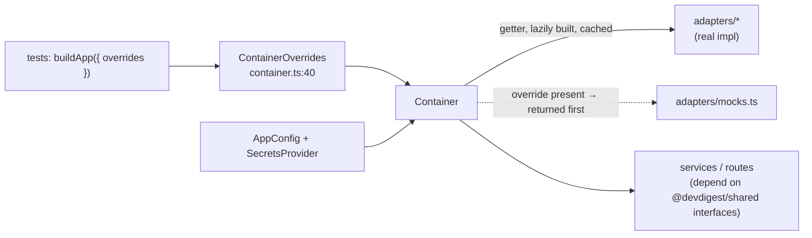
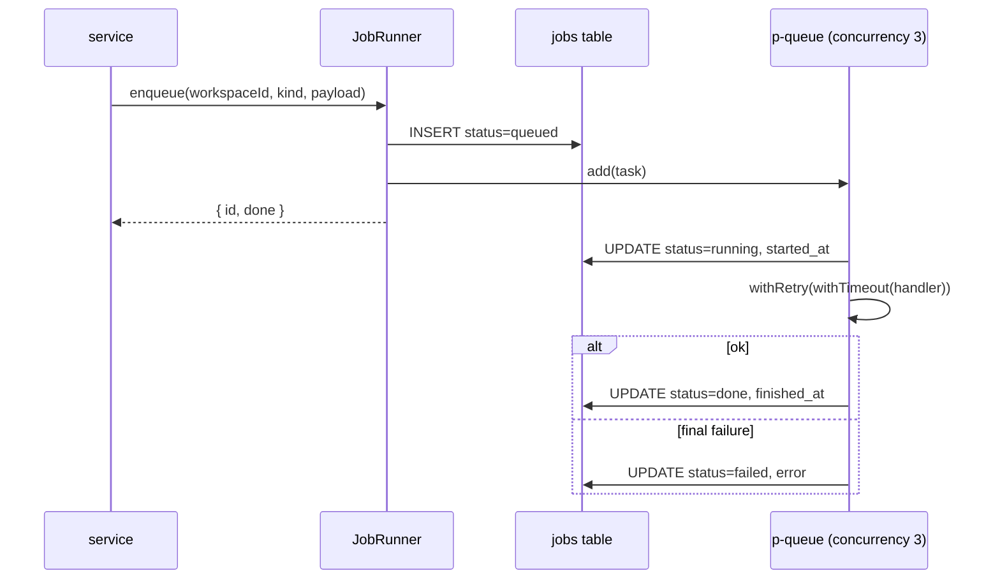
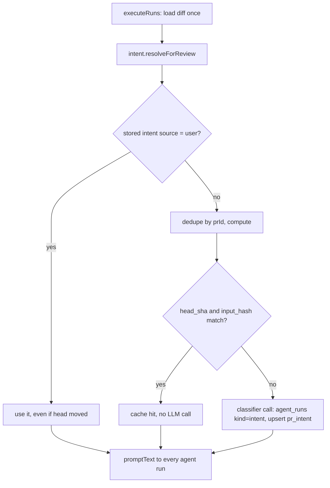

# `@devdigest/api` — architecture

How the server is wired and why. Behaviour that must stay true lives in [../specs/](../specs/); env vars, API map and run commands live in [../README.md](../README.md). Paths are relative to `server/src/`; `path:line` refs are for the working tree at time of writing.

## Boot sequence

`server.ts` → `loadConfig()` → `buildApp({ config })` → `app.listen({ port: apiPort, host: apiHost })` (`server.ts:29`, host defaults to `127.0.0.1`, `platform/config.ts:35`). `buildApp` (`app.ts:42`) does, in order:

1. create Fastify with a 1 MiB body cap (`app.ts:50`) and install the zod validator/serializer compilers (`app.ts:65-66`);
2. `new Container(config, db, overrides)` and `app.decorate('container', …)` (`app.ts:68-69`);
3. **await** `ReviewService.reapStaleRuns()` — before any request is accepted (`app.ts:82`);
4. `onRequest` host/origin guard (`app.ts:92`), then helmet, cors, SSE plugin, rate-limit (`app.ts:103-111`);
5. `/health`, `/health/ready` (`app.ts:114,118`), the error handler (`app.ts:130`);
6. register every plugin in `modules` (`app.ts:182`, registry `modules/index.ts:24`).

Everything the modules need arrives through `app.container`; there are no module-level singletons except `runBus` (see below).

## DI composition root

`platform/container.ts` is the only place that decides which concrete adapter is used. One `Container` per app instance (`container.ts:56`).



- **Override-first resolution.** Every adapter accessor checks `this.overrides.<x>` before building the real one (`git` `:89`, `codeIndex` `:105`, `repoIntel` `:116`, `depgraph` `:123`, `tokenizer` `:130`, `github()` `:155`, `llm(id)` `:165`, `embedder()` `:217`). `secrets` and `auth` are resolved eagerly in the constructor (`:83-84`).
- **Lazy + cached.** Real adapters are built on first use and memoised (`_git ??=`, `llmCache`). `invalidateSecretCaches()` (`:236`) drops LLM/GitHub/embedder caches after a key changes in Settings.
- **Missing key ⇒ `ConfigError` at use time, not at boot.** `buildLlm` (`:192`) and `github()` throw `ConfigError` (500, `config_error`) when the secret is absent; the server boots with no keys.
- **Candidate-key variants** `llmWithKey` (`:181`) and `githubWithToken` (`:188`) build uncached clients for "Test connection" so a typo never overwrites a working key.
- **Cross-module repositories** (`agentsRepo` `:97`, `reviewRepo` `:101`) are constructed here so modules do not import each other's `repository.ts`.
- **Cost attribution**: `priceBook` (`:142`) wraps live OpenRouter prices with the static `estimateCost` table; the OpenRouter provider receives `priceBook.estimate` as its cost hook (`:207-210`), OpenAI/Anthropic use the static table directly (`adapters/llm/openai.ts:84`, `anthropic.ts:85`).
- **Embeddings are config-gated**: `embedder()` throws `ConfigError` before touching OpenAI when `EMBEDDINGS_ENABLED` is not `true` (`:223`).
- **Two getters for PR intent.** `intent` (`container.ts:147`) returns `overrides.intent ?? this.intentService`; it is the `IntentResolver` the review executor calls, so a test can inject a fake. `intentService` (`:152`) is the real `IntentService`, built lazily and cached in `_intent` with narrow deps (`IntentRepository`, lazy `github()`, `git`, `llm(provider)`, `resolveFeatureModel(workspaceId, 'review_intent')`), and the intent routes always use it. Caveat: with `overrides.intent` set, the executor and the routes talk to different objects, so the in-flight map that dedupes a review and a "derive" click (below) is not shared in that setup.
- **No real network adapter under `NODE_ENV=test`.** `assertNoRealAdapterInTest` (`:252`) is called before `github()` and `llm(id)` build a real client from the developer's secrets (`:199`, `:221`) and throws `ConfigError` when `config.nodeEnv === 'test'`. A test that reaches GitHub or an LLM must inject a mock through `ContainerOverrides`; otherwise a machine with keys and CI (no keys) would behave differently. Covered by `test/container-test-guard.test.ts`.

## Ports and adapters

Port interfaces live in `vendor/shared/adapters.ts` (`LLMProvider` `:82`, `Embedder` `:91`, `GitHubClient` `:143`, `GitClient` `:205`, `CodeIndex` `:250`, `AuthProvider` `:268`, `SecretsProvider` `:281`). Services type against these, never against `adapters/*`.

| Port | Real adapter | Mock (`adapters/mocks.ts`) |
|------|--------------|----------------------------|
| `LLMProvider` | `llm/openai.ts`, `llm/anthropic.ts`, `OpenRouterProvider` from `reviewer-core` | `MockLLMProvider` `:58` — returns a caller fixture, validated against the request schema; fixed 100/50 tokens and `costUsd: 0.001` |
| `GitHubClient` | `github/octokit.ts` | `MockGitHubClient` `:130` |
| `GitClient` | `git/simple-git.ts` (`showFile` reads `<ref>:<path>` via `git show` after `assertShowFileArgs`) | `MockGitClient` `:254` |
| `CodeIndex` | `codeindex/ripgrep.ts` | `MockCodeIndex` `:299` |
| `Embedder` | `embedder/openai.ts` | `MockEmbedder` `:114` |
| `AuthProvider` | `auth/local.ts` (`LocalNoAuthProvider`, seeded user + `default` workspace) | `MockAuthProvider` `:312` |
| `SecretsProvider` | `secrets/local.ts` (`~/.devdigest/secrets.json`, env fallback) | `MockSecretsProvider` `:325` |

`DepGraph`, `Tokenizer`, `RemoteFetcher` (port in `modules/skills/types.ts`; adapter `adapters/http/index.ts`: https fetch for skill import whose socket `lookup` refuses private/loopback/link-local addresses, so the checked address is the connected one; mock `MockRemoteFetcher`) and `RepoIntel` are server-local ports (not in `@devdigest/shared`); `ContainerOverrides` exposes them too (`container.ts:49-53`).

`GitClient.showFile(repo, ref, path)` (`vendor/shared/adapters.ts`) reads a file as of a ref without touching the working tree. Both the real adapter and the mock call `assertShowFileArgs` (`adapters/git/show-file-guard.ts`) first, so invalid input is rejected before any git process starts: `ref` must be a 7–40 char hex sha or `pr-<digits>` (the local ref `fetchPullHead` creates); `path` must be non-empty, relative, and free of a NUL byte, a leading `-`, a drive prefix and any `..` segment. Covered by `test/git-adapter-safety.test.ts`. `getContext()` (`modules/_shared/context.ts:14`) resolves `{ workspaceId, userId }` through `AuthProvider`; every route calls it so workspace scoping is never skipped (see the scoping gaps in [../specs/review-flow.md](../specs/review-flow.md#workspace-scoping)).

Contract ownership across packages: root [CLAUDE.md](../../CLAUDE.md) Gotchas.

## Module layering

```
modules/<name>/routes.ts      Fastify plugin; zod `schema`; getContext(); delegates
        └─ service.ts         business logic; orchestrates, owns no SQL
             └─ repository.ts typed Drizzle queries; the only layer touching the DB
helpers.ts / constants.ts     pure functions / literals (no DB, no `this`)
```

Rules visible in code:

- Routes call `app.withTypeProvider<ZodTypeProvider>()` and put contracts on `schema.params/body`, so the handler gets parsed input (`modules/reviews/routes.ts:20`).
- **Exception A — routes-only modules**: listed in [../CLAUDE.md](../CLAUDE.md) Gotchas (e.g. `modules/pulls/routes.ts:28`).
- **Exception B — repository split**: `reviews/repository.ts` is a thin class composing per-aggregate query files in `reviews/repository/{review,run,pull}.repo.ts`.
- **Exception C — executor**: `reviews/service.ts` keeps the public surface; background execution lives in `reviews/run-executor.ts` (`ReviewRunExecutor`).
- **`modules/intent/`** follows the plain layering: `routes.ts` (`GET /pulls/:id/intent`, `POST /pulls/:id/intent/derive` rate-limited to 10/min, `PUT /pulls/:id/intent`) → `service.ts` (`IntentService`) → `repository.ts` (`IntentRepository`, the only Drizzle in the module: `pr_intent` plus the `kind='intent'` `agent_runs` rows). `helpers.ts` holds the pure parts (reference extraction, confidence, input hash, prompt rendering), `constants.ts` the caps. `IntentService` takes a narrow deps object, not the `Container`. The reviews module reaches it only through the `IntentResolver` port (`intent/types.ts`) via `container.intent`. `pr_intent` queries moved out of `reviews/repository`.
- `reviews/service.ts:34` builds its own `ReviewRepository` instead of `container.reviewRepo`; both are stateless over the same `db`.
- Registration is static (`modules/index.ts`) so the same path works under tsx, a bundler and vitest. Job-handler registration happens as a side effect of plugin load: `reposRoutes` calls `registerCloneJobHandler()` (`repos/routes.ts:24`), `repoIntelRoutes` calls `registerIndexJobHandlers()` (`repo-intel/routes.ts:30`, `repo-intel/service.ts:172`).

## Jobs: `JobRunner` (p-queue + `jobs` table)

`platform/jobs.ts`. Used for **clone, index, refresh, resync** — not for reviews (see next section).



- Defaults: concurrency 3, timeout 120 s, 2 retries (`jobs.ts:40-42`); `enqueue(…, { retries, timeoutMs })` overrides them per job (the conventions scan uses `retries: 0` so a failed LLM call is not paid for three times). Backoff is exponential from 250 ms capped at 8 s with jitter (`resilience.ts:46`).
- `enqueue` rejects with a plain `Error` (not `AppError`) when no handler is registered for `kind` (`jobs.ts:51`); callers that treat the follow-up as best-effort wrap it in `try/catch` (`repos/service.ts:69-79`, `repo-intel/routes.ts:52-60`).
- Retry only fires for HTTP 429/≥500 or `ECONNRESET`/`ETIMEDOUT`/`ENOTFOUND` (`resilience.ts:35`); a `TimeoutError` is not retried. `withTimeout` rejects but does not cancel the handler.
- The `jobs` table is a log/mirror, not a durable queue: queued/running rows left by a crash are never re-run or reaped. The only reader is the conventions module, which shows the latest `conventions.scan` row as the scan state and treats a left-behind row as `interrupted` by age (`modules/conventions/helpers.ts` `isStaleJob`). Payloads are persisted, so handlers must not trust them — `runCloneJob` rebuilds the clone URL from `owner/name` (`repos/service.ts:49-56`).
- Jobs chain by enqueueing, not calling: clone → `INDEX_JOB_KIND` (`repos/service.ts:69`); refresh enqueues clone + `REFRESH_JOB_KIND` (`:115-138`). Indexing internals: [../src/modules/repo-intel/README.md](../src/modules/repo-intel/README.md).

## Review runs are not jobs

`POST /pulls/:id/review` creates `agent_runs` rows, returns their ids, then starts `ReviewRunExecutor.executeRuns` fire-and-forget with `void …catch(log)` (`reviews/service.ts:133`). There is no queue, no timeout, no retry and no `jobs` row. Run state is `agent_runs.status`; liveness is the in-process `RunBus`. Full lifecycle: [../specs/review-flow.md](../specs/review-flow.md).

### PR intent inside a run

`executeRuns` loads the diff once for all queued agents, then calls `container.intent.resolveForReview(...)` **once** (`reviews/run-executor.ts:109`) and passes `resolvedIntent?.promptText` to each `runOneAgent` (`:133`), which sets `ReviewInput.intent` only when present. `resolveForReview` never throws: a failed derivation (no key, model or schema error) is written to the run log and the review continues without an intent section (`intent/service.ts:143-187`).



- The classifier call is recorded as an `agent_runs` row with `kind='intent'` and `agent_id` null (`intent/repository.ts` `createIntentRun`). `agent_runs.kind` is `'review' | 'intent'`, default `review` (`db/schema/runs.ts`).
- The run list and the active-run lookup of a PR filter on `kind = 'review'` (`reviews/repository/run.repo.ts:28`, `:54`), so intent runs never appear as agent runs.
- The PR-list `cost_usd` sums every `done` `agent_runs` row of the PR with a non-null cost and has no `kind` filter (`pulls/routes.ts:138-149`), so intent cost is counted there.
- `IntentService.inflight` (a per-PR map of promises) lets a review and a "derive" click on the same PR share one derivation (`intent/service.ts:192`).
- Stored in `pr_intent` (migration `db/migrations/0016_wild_taskmaster.sql`, schema `db/schema/reviews.ts`): `intent_class`, `rationale`, `confidence`, `sources` (jsonb), `source` (`model` | `user`), `head_sha`, `input_hash`, `provider`, `model`, `run_id` (no FK), `updated_at`; the same migration adds `agent_runs.kind`. The cache key is `(head_sha, input_hash)` (`intent/service.ts:267-274`); `inputHash` covers capped title, description, branch, commits, issues, docs and provider/model, not changed paths or diff stats (`intent/helpers.ts:299`).

## SSE run bus

`platform/sse.ts` — a process-global `runBus` singleton (`:103`) that `Container` exposes as `container.runBus` (`container.ts:85`). Single-process only, like the reaper.

- Per run it holds: an `EventEmitter`, an append-only event buffer, a `seq` counter, and `completed` / `cancelled` sets.
- `publish` assigns `seq = prev + 1`, stamps `t` as local `HH:MM:SS`, buffers and emits (`:51-59`).
- `subscribe` **replays the buffer first**, then attaches the live listener (`:63-67`); `onDone` fires immediately for an already-completed run so late subscribers end instead of hanging (`:90-98`).
- `GET /runs/:id/events` bridges the bus to an async generator for `fastify-sse-v2`; each frame is `{ id: String(seq), event: kind, data: JSON(RunEvent) }`, and the generator ends once `done` and the queue is drained (`reviews/routes.ts:55-90`). The route is exempt from rate limiting (`:50`).
- `RunLogger` (`platform/run-logger.ts:36`) is the single sink: it publishes to the bus, which doubles as the buffer persisted into `run_traces.trace.log`, and mirrors to pino. A logger can fan out to several `runIds` for shared pre-work (diff load) and is narrowed per agent with `forRun` (`:45`).
- Event kinds: `info | tool | result | error` (`vendor/shared/contracts/trace.ts:9`).

## HTTP boundary

Order of enforcement per request: `onRequest` guard (`app.ts:92`) → helmet/cors/rate-limit → route zod validation → handler → error handler (`app.ts:130`). Exact statuses and bodies: [../specs/api-error-envelope.md](../specs/api-error-envelope.md).

- **Why a Host/Origin guard on a loopback server**: binding to `127.0.0.1` stops LAN peers but not DNS rebinding from the user's own browser; CORS does not stop a "simple" cross-origin POST from being delivered. So `Host` must be in `allowedHosts` (`localhost`, `127.0.0.1`, `::1` + `API_ALLOWED_HOSTS`) and any `Origin` must be one of `http://localhost:<WEB_PORT>` / `http://127.0.0.1:<WEB_PORT>` (`config.ts:89-98`, `local-only.ts:36,42`). Requests with no `Origin` (curl, MCP, CLI) pass.
- **Why the global rate limit is skipped under test**: so `inject()` suites can hammer routes (`app.ts:109`). Limits themselves: [EE-15](../specs/api-error-envelope.md#other-transport-invariants).
- **No authentication** (root [CLAUDE.md](../../CLAUDE.md) Gotchas): `LocalNoAuthProvider` returns the seeded workspace/user (`auth/local.ts:14`).

## Testing seams

`buildApp({ config, db, overrides })` is the whole seam (`app.ts:29-33`): hermetic tests pass mock adapters in `overrides` and call `app.inject()`; `*.it.test.ts` suites additionally pass a Postgres `db`. See [../../TESTING.md](../../TESTING.md).

Integration tests share **one** Postgres container per run. `vitest.workspace.ts` defines two projects that extend `vitest.config.ts`: `unit` (everything except `*.it.test.ts`, never needs Docker) and `integration` (`test/**/*.it.test.ts`), whose `globalSetup` is `test/helpers/pg-global-setup.ts`. That setup starts a `pgvector/pgvector:pg16` container, runs the migrations into a template database (`devdigest_tpl`) and `provide`s `pgAdminUrl` / `pgTemplateDb` (typed in `vitest.d.ts`); without Docker it provides empty strings and suites skip via `dockerAvailable()`. `startPg()` in `test/helpers/pg.ts` clones the template per call with `CREATE DATABASE … TEMPLATE …` and drops the clone on `stop()`, so each file keeps its own database without its own container. Vitest runs a project's `globalSetup` only when the run selects a file of that project, so unit-only commands never reach Docker.
