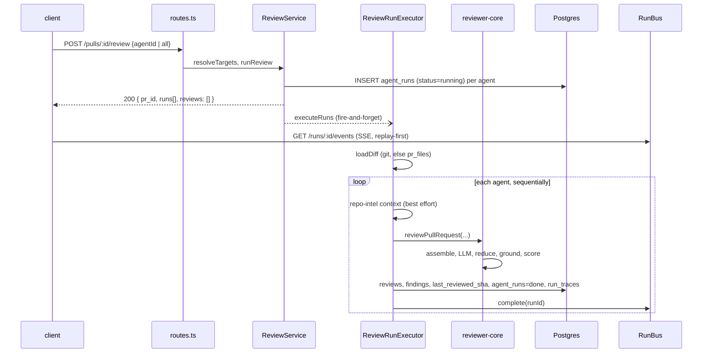

# Spec — review flow

The full cycle from `POST /pulls/:id/review` to persisted, grounded findings. Each `RF-n` is a checkable statement; `file:line` refs are `server/src/…` unless prefixed `reviewer-core/`. Wiring background: [../docs/architecture.md](../docs/architecture.md). PR import (precondition) is in [pr-import.md](pr-import.md); error bodies in [api-error-envelope.md](api-error-envelope.md).

## Endpoints

| Route | Handler | Notes |
|-------|---------|-------|
| `POST /pulls/:id/review` | `reviews/routes.ts:28` | body `{ agentId?, all? }`; 10/min rate limit (`:29`) |
| `GET /runs/:id/events` | `:49` | SSE, no rate limit (`:50`) |
| `GET /pulls/:id/runs/active` | `:95` | `status='running'` rows (`repository/run.repo.ts:10`) |
| `GET /pulls/:id/runs` | `:101` | all runs, `ran_at` desc (`run.repo.ts:40,50`) |
| `GET /runs/:id/trace` | `:121` | one `run_traces` document |
| `GET /pulls/:id/reviews` | `:129` | reviews newest-first with findings |
| `POST /runs/:id/cancel` | `:114` | see [Cancellation](#cancellation) |
| `DELETE /runs/:id` | `:107` | run + its review + trace |
| `DELETE /reviews/:id` | `:135` | review + findings |
| `POST /findings/:id/accept\|dismiss` | `:143` | triage |

## 1. Run creation (synchronous part)

- **RF-1** `:id` must be a uuid, else 422 (`IdParams`, `modules/_shared/schemas.ts`). The body is parsed manually with `RunRequest.parse(req.body ?? {})` (`routes.ts:32`), so an empty/absent body is valid and a bad body is a `ZodError` mapped to 422.
- **RF-2** Target resolution (`reviews/service.ts:46`): `all` truthy → `agentsRepo.listEnabled(workspaceId)` (wins over `agentId`); else `agentId` → `getById`, missing → 404 `not_found`; neither → 400 `invalid_run_request` (`service.ts:56`).
- **RF-3** The PR must exist **in the caller's workspace** (`pull.repo.ts:9`) else 404 "Pull request not found"; its repo must exist else 404 "Repo not found" (`service.ts:110-114`).
- **RF-4** One `agent_runs` row per target is inserted **before** the response, sequentially, with `status='running'`, `source='local'`, and the agent's `provider`/`model` (`service.ts:120`, `run.repo.ts:117-137`). `run_id` is `agent_runs.id`.
- **RF-5** The response is `200 { pr_id, runs: [{ run_id, agent_id, agent_name }], reviews: [] }`. `reviews` is always empty (`service.ts:137`); results are read later via `GET /pulls/:id/reviews`.
- **RF-6** Execution is fire-and-forget: `void executor.executeRuns(...).catch(log)` (`service.ts:133`). It does **not** use `JobRunner`: no `jobs` row, no timeout, no retry.

## 2. Context assembly (`reviews/run-executor.ts`)

- **RF-7** One `RunLogger` fans out over all queued run ids (`run-executor.ts:65`); shared pre-work events land in every run's buffer and therefore in every run's persisted trace.
- **RF-8** Diff load (`diff-loader.ts:20-37`): `container.git.diff({owner,name}, pull.base, pull.headSha)`; if that throws **or** yields zero files, the diff is rebuilt from `pr_files.patch` rows (rows with null patch are skipped). The result is a parsed `UnifiedDiff`.
- **RF-9** If the diff load throws, **every** queued run is failed together: `status='failed'`, `error='Failed to load PR diff: …'`, tokens 0, `cost_usd` null, `grounding='0/0 passed'`, a trace built from the bus buffer is saved, and the bus completes (`run-executor.ts:75-105`).
- **RF-10** Agents run **sequentially** in request order (`run-executor.ts:108`); a failure in one never aborts the next (`:126-134`).
- **RF-11** The provider comes from `container.llm(agent.provider)` (`:161`). A missing key throws `ConfigError`, which is caught below and persisted as a failed run (not a 5xx on the original request).
- **RF-12** Repo-intel enrichment runs only when `agent.repoIntel !== false` (`:169`). Three best-effort inputs: callers digest (`getCallerSignatures(repoId, changedFiles, 10)`, `:340`), repo map (omitted when `degraded` or blank, `:374`), rank note (only files with `percentile >= 95`, `:398`). Any enrichment error is logged as an `info` event (the rank note swallows it silently, `:402`) and the input is omitted; enrichment can never fail a run.
- **RF-13** The task text is `taskLine(pull)` (`reviews/helpers.ts:82`) plus the rank note. It instructs the model to review the whole diff, allow zero findings, and never downgrade a security/correctness finding because of PR text. PR body is passed as `prDescription` only when non-empty (`:206`).
- **RF-14** `skills`, `memory` and `specs` are **not** passed in the starter; the persisted trace has `memory_pulled: []`, `specs_read: []` (`:282-283`).

## 3. Engine call (`reviewer-core/src/review/run.ts`)

Engine behaviour (mode selection, cancellation checkpoints, repair retries, reduce, grounding, score) is owned by `reviewer-core` and pinned in [review-contract.md](../../reviewer-core/specs/review-contract.md) and [grounding.md](../../reviewer-core/specs/grounding.md). The server-side invariants are:

- **RF-15** The strategy passed is `agent.strategy ?? 'single-pass'` (`run-executor.ts:198`). The fallback is dead code: `agents.strategy` is `notNull default 'single-pass'` (`db/schema/agents.ts:20`).
- **RF-16** The executor passes `checkCancelled` that throws `RunCancelledError` when `runBus.isCancelled(runId)` (`run-executor.ts:210-211`). The engine calls it before each chunk's LLM call (reviewer-core C4), so a single-pass run has exactly one checkpoint.
- **RF-17** Tokens and cost recorded on the run are the engine's chunk totals (reviewer-core C12).
- **RF-18** The persisted `verdict` is the model's and the persisted `score` is the engine's recomputation (reviewer-core C9, C10).

## 4. Grounding and scoring

- **RF-19** Only findings kept by the grounding gate are persisted (reviewer-core R1–R4); drops are emitted as `info` events into the run log.
- **RF-20** Pinned server-side example: one kept CRITICAL ⇒ score 65 (`test/reviews.it.test.ts:160`).
- **RF-21** The engine's `grounding` string (reviewer-core G7) is stored on `agent_runs.grounding` and `trace.stats.grounding`.

## 5. Persistence (success path)

Written in this order, as independent statements (no transaction wraps them):

1. **RF-22** `reviews` row: `kind='review'`, `agent_id`, `run_id`, model's `verdict`/`summary`, recomputed `score`, `model=agent.model` (`run-executor.ts:219`). `reviews.run_id` has **no FK** to `agent_runs` (`db/schema/reviews.ts:19`).
2. **RF-23** `findings` rows for the kept findings only; `kind` defaults to `'finding'`; `accepted_at`/`dismissed_at` null (`review.repo.ts:29-55`). `evidence` is not persisted (`reviews/helpers.ts` returns `evidence: null`).
3. **RF-24** `pull_requests.last_reviewed_sha := pull.headSha` (`run-executor.ts:235`, `pull.repo.ts:40`). This drives the `needs_review/reviewed/stale` status ([pr-import.md](pr-import.md#review-status-derivation)).
4. **RF-25** `agent_runs` updated to `status='done'` with `duration_ms`, `tokens_in/out`, `cost_usd`, `findings_count = rows inserted`, `grounding`, `score`, `blockers = countBlockers(kept, agent.ciFailOn)`, `error=null` (`:244-255`). `blockers` is a run-time snapshot, not live triage state.
5. **RF-26** `run_traces` upserted by `run_id` (`run.repo.ts:179-184`): `config{agent,version,provider,model,pr,source:'local'}`, `stats`, `prompt_assembly`, `tool_calls` (one `review_file` entry per chunk), `raw_output`, `log` = the run's full bus buffer including shared pre-work (`:257-289`). One document per run; deleting the run cascades it (`db/schema/runs.ts:35-40`).
6. **RF-27** `runBus.complete(runId)` is called **last** (`:290`). A client that refetches on SSE `done` always sees the review, run row and trace.

## 6. Failure and cancellation paths

- **RF-28** Any throw inside a single agent's run (provider, LLM, grounding, DB) is caught in `runOneAgent` (`:293`): `status` = `'cancelled'` for `RunCancelledError`, else `'failed'`; `error` = `'Cancelled by user'` or the message; tokens 0, `cost_usd` null, `findings_count` 0, `grounding='0/0 passed'`; trace built from the buffer; bus completed; error re-thrown to `executeRuns`, which only logs (`:297-317`).
- **RF-29** Consequence: tokens and cost spent by a run that fails after the LLM call are **not** recorded (zeroed at `:304-306`).
- **RF-30** Terminal statuses are exactly `done | failed | cancelled`; `agent_runs.status` is free `text` in the schema (`runs.ts:22`), so this is enforced by TypeScript only (`repository.ts` `completeAgentRun` signature).

### Stale-run reaping

- **RF-31** `buildApp` **awaits** `ReviewService.reapStaleRuns()` before registering plugins or listening (`app.ts:82`), so a fresh process has no live runs of its own and every `running` row is orphaned. It updates **all** rows with `status='running'` to `'failed'` and returns the count (`run.repo.ts:105-112`), logged at info when > 0. A reaper error is logged and non-fatal (`app.ts:84-86`).
- **RF-32** The reaper sets only `status`. It does **not** set `error`, `duration_ms`, or write a trace, and it is not workspace-scoped. A reaped run therefore has `error = null` and `GET /runs/:id/trace` returns 404 for it.
- **RF-33** Single-instance assumption: [../CLAUDE.md](../CLAUDE.md) Gotchas (`app.ts:79`).

### Cancellation

- **RF-34** `POST /runs/:id/cancel` → `ReviewService.cancelRun` (`service.ts:85-90`): publish an info event, `runBus.cancel(runId)`, `cancelRunIfRunning` (`UPDATE … SET status='cancelled' WHERE id=? AND status='running'`, `run.repo.ts:94-101`), then `runBus.complete(runId)`. Response `{ ok: true }` regardless of whether anything was running. Works for orphaned runs because the DB row is updated directly.
- **RF-35** Intended: a live runner stops at its next checkpoint (RF-16), persists `status='cancelled'`, `error='Cancelled by user'`.
- **KNOWN GAP (open)** `RunBus.complete` deletes the `cancelled` flag (`platform/sse.ts:79`) and `cancelRun` calls it immediately after one awaited UPDATE (`service.ts:89`). Unless the engine reaches a checkpoint in that window, `isCancelled` is already false and the run continues; `completeAgentRun` is an unconditional update by id (`run.repo.ts:161-175`), so it would then overwrite `cancelled` with `done`. Not covered by tests (`grep cancel test/` hits only `test/helpers/runs.ts`).

## 7. SSE stream

- **RF-36** `GET /runs/:id/events` replays the run's buffered events, then streams live ones, and ends after `done` once the queue drains (`reviews/routes.ts:55-90`). Frame: `id = seq`, `event = kind` (`info|tool|result|error`), `data = JSON(RunEvent{runId,seq,kind,msg,t,data?})` (`:80-84`).
- **RF-37** `seq` is per-run, starts at 1, strictly increasing (`sse.ts:53-54`); `t` is local `HH:MM:SS`.
- **RF-38** A subscriber arriving after completion gets the full replay and then the stream ends (`sse.ts:90-98`; test `reviews.it.test.ts:360`).
- **KNOWN GAP (open)** A run id the bus has never seen in this process (reaped run, or server restarted) is never "completed": the stream stays open, silent, until the client disconnects (`onDone` → `emitterFor` at `sse.ts:97`).
- **KNOWN GAP (open)** `complete()` frees only the emitter; per-run `buffers`, `seq` and `completed` are never deleted (`sse.ts:76-84`; no `delete` of those maps anywhere), so memory grows with run count until restart.

## 8. Cost tracking

- **RF-39** Per-call `costUsd` comes from the adapter: OpenAI/Anthropic via the static table `estimateCost` (`adapters/llm/pricing.ts:37`), OpenRouter via `PriceBook.estimate` (live `/models` prices, 6 h TTL, synchronous; cold or failed cache falls back to the static table; `platform/price-book.ts:34`).
- **RF-40** An unpriced model yields `null` (`pricing.ts:39`); how chunk costs combine into the run total is reviewer-core C12.
- **RF-41** The total is a **snapshot** stored on `agent_runs.cost_usd` (double precision) at completion and never recomputed. It is surfaced as `cost_usd` on `GET /pulls/:id/runs` (`run.repo.ts:62`), `trace.stats.cost_usd`, and `GET /repos/:id/pulls` via `reviews.run_id → agent_runs` left join for the **latest** review (`pulls/routes.ts:120-134`); `null` for never-reviewed PRs. Pinned by `test/reviews.it.test.ts:215` (single-pass mock run ⇒ 100/50 tokens, `0.001`).

## 9. Triage and deletion

- **RF-42** `POST /findings/:id/accept|dismiss`: the finding's PR must belong to the caller's workspace, else 404 "Finding not found" (`reviews/findings.ts:18`). Accept sets `accepted_at` and clears `dismissed_at`; dismiss does the inverse, so the two are mutually exclusive (`review.repo.ts:126,139`). Returns `{ finding }`.
- **RF-43** `FindingActionKind` in the contract also lists `learn` and `reply` (`vendor/shared/contracts/findings.ts:90`) but only `accept`/`dismiss` are routed (`reviews/routes.ts:18`).
- **RF-44** `DELETE /runs/:id` deletes the run's `reviews` (workspace-scoped) first, because `reviews.run_id` has no FK, then the `agent_runs` row (trace cascades); returns `{ ok: boolean }` (no 404) (`run.repo.ts:78-91`). `DELETE /reviews/:id` returns 404 when absent; findings cascade (`review.repo.ts:83`).
- **RF-45** PR-list `severity_counts` tallies the latest review's findings with `dismissed_at IS NULL`, so it tracks triage live; `agent_runs.blockers` does not (`pulls/routes.ts:142`; test `reviews.it.test.ts:272`). *(uncommitted working-tree change at time of writing)*

## Workspace scoping

Scoped by `workspace_id`: run creation, `GET /pulls/:id/(runs|runs/active|reviews)`, `DELETE /runs/:id`, `DELETE /reviews/:id`, finding actions. **Not** scoped (route calls `getContext` but the lookup is by run id only): `GET /runs/:id/events`, `GET /runs/:id/trace`, `POST /runs/:id/cancel`, and the boot reaper. Harmless with the single seeded workspace; must change before multi-workspace.

## Tests that pin this

`test/reviews.it.test.ts` (run + grounding `:160`, cost `:215`, severity counts `:272`, finding actions `:329`, SSE `:360`, run-all `:386`), `test/grounding.test.ts`, `test/reviews-helpers.test.ts`, `reviewer-core/test/`.
