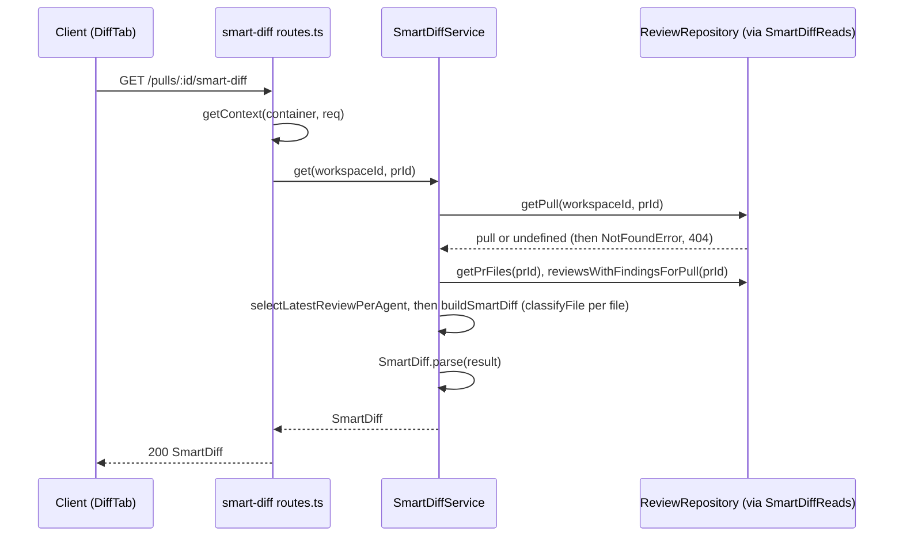

<!-- planner-spec -->
# Spec — Smart Diff (role-ordered Files changed tab with inline agent findings)

## Goal
On a PR's **Files changed** tab, a reviewer sees the files ordered by role (core → tests → wiring → docs → boilerplate), with the review findings shown inside the diff: a per-group counter, a dot on each file that has findings, and an inline finding card under the code line. A segmented toggle switches between **Smart order** (the default) and **Original order** (GitHub order, which is how the tab works today). The reviewer reads the substance first, skips the noise, and acts on findings where the code is.

Traceability: every requirement has an ID `FR-0NN`, and its alias `R<N>` uses the same number (FR-001 = R1, …). Priorities: **P1** must ship for the demo, **P2** and **P3** are mandatory too (the task makes all three mandatory).

## Non-goals
- No LLM call, no `pseudocode_summary`, no real `split_suggestion` (`too_big` is always `false` and `proposed_splits` is always `[]`).
- No change to the Agent runs / Findings tab. It keeps `runs.flatMap(r => r.findings)` (`page.tsx:72-75`).
- No DB schema change and no migration.
- No use of the classifier as a prompt filter. That comes later. This task only makes `classifyFile` importable without HTTP.
- No GitHub-comment behaviour change except that the toggle now also controls findings.
- No change to `reviewer-core`.

## Context
All of the following was read in this run unless marked *(brief)*. *(brief)* means the fact comes from the delegation prompt and was not re-read here.

**Contracts**
- `server/src/vendor/shared/contracts/brief.ts:168-201`: `SmartDiffRole = z.enum(['core', 'wiring', 'boilerplate'])` (:169); `SmartDiffFile {path, pseudocode_summary: nullish, additions, deletions, finding_lines: int[]}` (:172-178); `SmartDiffGroup {role, files}` (:181-184); `SmartDiff {groups, split_suggestion{too_big, total_lines, proposed_splits}}` (:193-200).
- `client/src/vendor/shared/contracts/brief.ts:166-199` holds the same Smart Diff block. Outside it, the two copies differ only in comments (verified):
  - client :16 says "fed to the reviewer prompt"; server :16 says "feeds the reviewer prompt".
  - the client has a doc comment at :33 that the server lacks.
  - the client compresses the comment at :63, where the server has a multi-line comment at :62-66.
  - the client has a comment at :90 that the server lacks.
- `server/src/vendor/shared/contracts/review-api.ts:63-65`: `export const SmartDiffResponse = SmartDiff;`.

**Server**
- `server/src/modules/index.ts:12` imports `intent from './intent/routes.js'`. The registry object is at :27-39. The comment at :24 names "intent/smart-diff" as a later module.
- `server/src/modules/intent/routes.ts:18` reads `const service = container.intentService;`, a service built as a Container getter. Handler shape at :20-23: `getContext` → one service call.
- `server/src/modules/intent/service.ts:46-55` defines `IntentServiceDeps { repo: IntentRepository; … }`, the narrow-deps pattern (onion rule 8).
- `server/src/modules/intent/repository.ts:19-25` has a workspace-scoped `getPull` (`and(eq(workspaceId), eq(id))`). `:43-45` has `getPrFiles(prId)`, a select on `t.prFiles` by `prId` with **no ORDER BY**.
- `server/src/modules/reviews/repository/review.repo.ts:57-74`: `reviewsForPull` returns reviews "newest first" (`orderBy(desc(t.reviews.createdAt))`), each with its findings.
- `server/src/modules/reviews/run-executor.ts:252-263`: `insertReview(...)` / `insertFindings(...)` run inside the `try`, before `completeAgentRun({status:'done'})` at :313-324. The `catch` at :328-352 marks the run `failed` / `cancelled` and **never inserts a review**. Inferred: a persisted `kind='review'` row exists only for a run that reached its success path, so "the latest review per agent" equals "the latest completed run per agent". The exceptions are the short window between :252 and :313 and a throw after :252 (see Risks).
- `server/src/modules/reviews/routes.ts:129-132` serves `GET /pulls/:id/reviews`. `:143-149` serves `POST /findings/:id/{accept|dismiss}`.
- `server/src/modules/pulls/routes.ts:193-285` serves `GET /pulls/:id`. With a GitHub token it deletes and re-inserts `pr_files` from GitHub before returning (:215-226). Without one it serves the persisted rows (:254, :271-276). Inferred: a `smart-diff` request issued **after** the detail response reads the same `pr_files` rows.
- `server/src/db/schema/pulls.ts:36-45`: `pr_files {id uuid, pr_id, path, additions, deletions, patch text nullable}`.
- `server/src/db/seed.ts`:
  - :120-126 seeds 4 `pr_files` rows **without a patch**.
  - :137-149 seeds a review with `kind:'review'` and **no `agentId` / `runId`**.
  - :151-176 seeds the findings `src/config.ts:12` (CRITICAL) and `src/api/users.ts:45-52` (WARNING).
  - All of this runs only inside `if (!pr)` (:99).

**Client**
- `client/src/app/repos/[repoId]/pulls/[number]/page.tsx`:
  - :40 `usePrReviews(prId)` with `refetchReviews`.
  - :72-75 `runs.flatMap((r) => r.findings)`.
  - :132 `onRunStart={() => setTab("findings")}`: starting a run switches to the findings tab.
  - :156-160 `onRunDone` invalidates `pr-active-runs` / `pr-runs` and calls `refetchReviews()`.
  - :164-171 renders `<DiffTab prId filesCount files canComment>`.
  - :110-121 means DiffTab only renders after `pr` has loaded.
- `…/_components/DiffTab/DiffTab.tsx`:
  - :21-22 `showComments` defaults to `false`.
  - :48-57 the toggle renders only when `commentCount > 0`.
  - :55 has hard-coded English "Hide comments" / "Show comments".
  - :60 header `Files changed · {filesCount} files`.
  - :62 `<DiffViewer files commenting>`.
- `client/src/components/diff-viewer/DiffViewer/DiffViewer.tsx:27-29` is a flat `files.map(f => <FileCard …/>)`.
- `client/src/components/diff-viewer/FileCard/FileCard.tsx`:
  - :35-37 auto-expands when `additions + deletions <= AUTO_EXPAND_MAX_LINES`.
  - :43-49 partitions threads into matched / outdated.
  - :67-74 comment counter (`Icon.MessageSquare`).
  - :81-89 `CodeLine` per parsed line.
  - :91 `OutdatedComments` when `showComments`.
- `client/src/components/diff-viewer/CodeLine/CodeLine.tsx:67-71` renders threads under the line when `commenting.showComments`.
- `client/src/components/diff-viewer/comments.ts`:
  - :63-74 `keysForLine`: `add` / `ctx` lines → `RIGHT:<newNo>`; `del` / `ctx` lines → `LEFT:<oldNo>`.
  - :89-106 `partitionThreads` returns matched vs outdated, "so nothing is silently dropped".
- `client/src/components/diff-viewer/helpers.ts:12-38`: `parsePatch` → `Line {kind, text, oldNo?, newNo?}`.
- `client/src/components/diff-viewer/constants.ts:4`: `AUTO_EXPAND_MAX_LINES = 200`.
- `client/src/components/diff-viewer/index.ts:3-4` exports only `DiffViewer` and `DiffCommentApi`. `client/src/test/smoke.test.tsx:5` imports `DiffViewer`.
- `…/_components/FindingCard/FindingCard.tsx`:
  - :23 uses a deep relative import `../../../../../../../lib/github-urls`.
  - :44 is the collapsible `expanded` state.
  - :50-52 `muted = accepted || dismissed`.
  - :91-111 Accept / Dismiss via `onAction`.
  - `constants.ts:4-9` defines `SEV_COLOR` (`var(--crit)`, `var(--warn)`, `var(--sugg)`, `var(--info)`).
  - `styles.ts:5-23` uses per-side border longhands.
  - `helpers.ts:1` re-exports `lineLabel` from `@/lib/findings`.
- `…/_components/FindingsPanel/FindingsPanel.tsx:13` reads `import { FindingCard } from "../FindingCard";`. It is the only importer besides FindingCard's own test.
- *(brief)* `client/src/lib/hooks/reviews.ts:51` `usePrReviews` with queryKey `["reviews", prId]`, and `:139` `useFindingAction()`. *(brief)* `SEV` / `SeverityBadge` live in `client/src/vendor/ui/primitives/Badge.tsx`. *(brief)* `client/messages/en/prReview.json` has a `smartDiff` namespace.

**Project rules**
- `client/INSIGHTS.md:24`: import only types from `@devdigest/shared` in client code.
- `client/INSIGHTS.md:11`: never pair `borderColor` with `borderLeft*`.
- `client/INSIGHTS.md:15`: the global `MutationCache.onError` already toasts mutation errors.
- `server/INSIGHTS.md:40`: open question whether `new XRepo(container.db)` in route setup is allowed.
- `TESTING.md:79-82`: DB-backed tests import `test/helpers/pg.ts` and end in `.it.test.ts`.

**e2e**
- `e2e/specs/flow-format.md`:
  - F1/F2: `NN-` zero-padded names.
  - F4: deterministic locators only.
  - F8: match rendered (CSS-uppercased) text.
  - Authoring checklist :52-55: seeded data only, no Run Review, no mutation, and update `seed-fixtures.md` + `coverage.md`.
- Existing flows: `01`–`09` (glob), so the next number is `10`.
- `e2e/specs/seed-fixtures.md`:
  - :8 (S2): seed fixtures are inserted only inside `if (!pr)`.
  - :41 (S4): flow `04` hard-codes `2 findings`.
  - :43 (S6): flows must not assert a file count.

**Libraries**
No new library. No Context7 lookup was needed: glob matching is hand-written with RegExp (see Design), and zod `.parse` is already used in the codebase (`reviews/routes.ts:32` `RunRequest.parse`).

## Requirements
### Shared
- **FR-001** (R1, P1) `SmartDiffRole` is `z.enum(['core','tests','wiring','docs','boilerplate'])`, in this order, in `server/src/vendor/shared/contracts/brief.ts`. The client copy is byte-identical to the server copy after this change.
- **FR-002** (R2, P1) When a client calls `GET /pulls/:id/smart-diff` for a PR in its workspace, the API shall return 200 with `groups` holding exactly 5 entries, roles in the order `core, tests, wiring, docs, boilerplate`. Empty groups are included.
- **FR-003** (R3, P2) The service shall run the response through `SmartDiff.parse(...)` before returning it. A shape violation is a 500, never a malformed 200.

### Backend
- **FR-004** (R4, P1) `classifyFile(path)` shall be a pure function (no I/O, no imports outside its module's `constants.ts` and the shared types). It returns the role of the **first matching** rule set, evaluated in the order boilerplate → tests → wiring → docs, and `core` when nothing matches. The patterns are those listed in Design.
- **FR-005** (R5, P1) `classifyFile` returns these results for the contested cases:
  - `__tests__/__snapshots__/x.snap` → `boilerplate`
  - `.claude/skills/security/SKILL.md` → `wiring`
  - `e2e/README.md` → `tests`
- **FR-006** (R6, P1) Every `pr_files` row of the PR appears in exactly one group. Within a group, files keep the order the repository returned them in.
- **FR-007** (R7, P1) `finding_lines` of a file shall be the ascending, de-duplicated `start_line` values of the **selected findings** (FR-008) whose `file` equals the file's `path`.
- **FR-008** (R8, P1) The selected findings shall be the findings of the latest review per agent:
  - consider reviews with `kind = 'review'`;
  - group them by `agent_id`, where all reviews with a `null` `agent_id` form one bucket;
  - keep the newest by `created_at`, tie-broken by greater `id`.
  - Accepted and dismissed findings stay selected.
- **FR-009** (R9, P2) When the PR has no review, the endpoint shall return 200 and every `finding_lines` shall be `[]`.
- **FR-010** (R10, P2) The smart-diff service must not call an LLM. Its deps type contains no LLM provider.
- **FR-011** (R11, P1) `split_suggestion` shall be `{ too_big: false, total_lines: Σ(additions + deletions) over all files, proposed_splits: [] }`.
- **FR-012** (R12, P1) When the PR does not exist or belongs to another workspace, the endpoint shall return 404 with the error envelope (`NotFoundError`).
- **FR-013** (R13, P1) The seed shall give PR #482 at least one file of each of the 5 roles. It shall also give `src/config.ts` a patch that renders new line 12, and give `src/api/users.ts` a patch that does **not** contain line 45.

### Frontend
- **FR-014** (R14, P1) The Files changed tab shall show a segmented toggle "Smart order" / "Original order", with Smart order selected by default.
- **FR-015** (R15, P1) When Original order is selected, the tab shall render the flat `PrFile[]` list in the order `GET /pulls/:id` returned it, as today.
- **FR-016** (R16, P1) The tab header shall show "Reviewer-ordered diff" and "N files · +A −D". N is the count of `files`, A is Σ additions and D is Σ deletions.
- **FR-017** (R17, P1) In Smart order, the non-empty groups shall render in the order of the server's `groups`. Each header shows a colour square, the role label, the role description and "N files".
- **FR-018** (R18, P1) A group header shall show "● N" when N > 0. N is the number of **files** in the group that have ≥ 1 selected finding.
- **FR-019** (R19, P1) The docs and boilerplate groups shall start collapsed. Core, tests and wiring start expanded. Clicking a group header toggles it.
- **FR-020** (R20, P1) File auto-expand must not change: a file is open iff `additions + deletions ≤ 200`.
- **FR-021** (R21, P3) A group header shall stay sticky at the top of the scroll area while its files scroll.
- **FR-022** (R22, P1) A file header shall show a red dot (no number) next to the path when the file has ≥ 1 selected finding. The dot is a separate element from the GitHub comment counter.
- **FR-023** (R23, P1) A selected finding whose `RIGHT:${start_line}` key is among the file's rendered line keys shall render as a finding card directly under that line.
- **FR-024** (R24, P1) A line that hosts a finding card shall show a left colour bar and a right-side label: CRITICAL → "blocker", WARNING → "warning", SUGGESTION → "suggestion". The colours are the existing severity colours.
- **FR-025** (R25, P1) The inline card shall show severity, title, rationale and the suggested fix, plus Accept and Dismiss buttons.
- **FR-026** (R26, P1) Clicking Accept or Dismiss on the inline card shall call `POST /findings/:id/{accept|dismiss}` through `useFindingAction`. Afterwards the card shows the new state without a page reload.
- **FR-027** (R27, P1) An accepted or dismissed finding shall render muted and shall still count in FR-018 and FR-022.
- **FR-028** (R28, P3) The inline card shall collapse to its one-line header on click and expand again on a second click.
- **FR-029** (R29, P2) Selected findings of a file whose key is not rendered (line not in the patch, or no patch) shall render in a block at the end of that file's body. They must not be dropped.
- **FR-030** (R30, P2) Finding cards (inline and unanchored) shall be shown and hidden by the same toggle as GitHub comments.
- **FR-031** (R31, P2) The show/hide toggle shall render when there are GitHub comments or selected findings.
- **FR-032** (R32, P3) When the PR has no reviews, the tab shall show a "review not run yet" note in place of the "● N" counters.
- **FR-033** (R33, P3) When a review run completes, the counters, dots and cards shall update without a page reload.
- **FR-034** (R34, P3) Every new user-facing string shall come from `client/messages/en/prReview.json` → `smartDiff`.
- **FR-035** (R35, P1) The diff must not use `runs.flatMap(r => r.findings)`. It shall use one client selector, `selectLatestFindings(reviews)`, that implements the FR-008 rule.
- **FR-036** (R36, P1) `FindingCard` shall move to `client/src/components/finding-card/`. The Findings tab shall render exactly as before.

### e2e
- **FR-037** (R37, P1) Flow `e2e/flows/10-smart-diff.flow.json` shall assert:
  - the Smart-order group labels are present;
  - the boilerplate group is collapsed and `pnpm-lock.yaml` appears after the group is expanded;
  - the seeded CRITICAL finding card and its "blocker" label appear on `src/config.ts`;
  - the Original-order toggle renders the flat list.

## Success criteria
- **SC-001** `pnpm typecheck` exits 0 in `server/` and in `client/`, and `npm run typecheck` exits 0 in `reviewer-core/` and `e2e/`.
- **SC-002** `diff server/src/vendor/shared/contracts/brief.ts client/src/vendor/shared/contracts/brief.ts` exits 0.
- **SC-003** `server/test/smart-diff-classify.test.ts` passes, with ≥ 1 row per pattern in the brief plus the 3 contested cases.
- **SC-004** `server/test/smart-diff.it.test.ts`:
  - `GET /pulls/:id/smart-diff` → 200;
  - `SmartDiff.safeParse(body).success === true`;
  - `body.groups.map(g => g.role)` equals the 5-role array;
  - an unknown id → 404;
  - the count of `agent_runs` rows is unchanged by the GET.
- **SC-005** The client tests in the Test plan pass under `pnpm test` in `client/` (exit 0).
- **SC-006** `./scripts/e2e.sh` reports flow `10-smart-diff` passed, and flows `04` and `05` still pass.
- **SC-007** The four grep commands in the onion-architecture skill §7, run in `server/`, show no new hit.

## Constraints
- **Onion**: the route handler does `schema` → `getContext` → one service call. The module has no SQL: the service depends on a local `SmartDiffReads` interface (`smart-diff/types.ts`) and the Container passes `container.reviewRepo`, which already exposes `getPull`, `getPrFiles`, `reviewsForPull`. The module never imports `reviews/*` or `intent/*` `service.ts`, `repository.ts` or `routes.ts`.
- **Contract mirror**: `server/src/vendor/shared` is the source of truth. Mirror it into `client/src/vendor/shared`. `reviewer-core` consumes the server copy through an alias, so any `SmartDiffRole` use there must still typecheck (see Open questions).
- **Client**:
  - type-only imports from `@devdigest/shared` (`client/INSIGHTS.md:24`);
  - `src/components/*` never imports `src/app/*` (client-layout §4);
  - per-side border longhands (`client/INSIGHTS.md:11`);
  - no local toast on mutation errors (`client/INSIGHTS.md:15`);
  - every component folder gets an `index.ts`;
  - case-only renames go through `git mv`.
- **Protected files**: no migration and no lockfile change. No new dependency.
- **e2e**: seeded data only. No Run Review click and no Accept/Dismiss click (`flow-format.md` checklist 2).
- **CI**: the paths touched (`server/**`, `client/**`, `e2e/**`) are already covered by their per-package workflows. No new alias is added.

## Assumptions
- **Agentless reviews form one bucket.** Reviews with `agent_id = null` (the seeded review, `seed.ts:137-149`) count as one "agent" bucket. Without this the seeded PR would show no findings in the diff and e2e could not cover the cards.
- **"Completed" means "a persisted `kind='review'` row".** There is no join on `agent_runs.status`, because the client's `ReviewRecord` carries no run status and both sides must apply the identical rule. Basis: `run-executor.ts:252` vs `:328-352`.
- **The server always returns 5 groups, empty ones included.** The client hides empty groups.
- **Group indicators come from the client selector** over `usePrReviews`. Counter, dot and cards then always agree with the cards shown. The server's `finding_lines` follows the same rule and is pinned by server tests. It is not used for rendering, so there is no second source that could lag.
- **Within a group, the client orders files by their index in `files` (Original order).** `pr_files` has no order column (`schema/pulls.ts:36-45`) and the server select has no ORDER BY, so the client's order is the deterministic one.
- **Show/hide default**: annotations are shown when selected findings exist, otherwise hidden (today's default, `DiffTab.tsx:21-22`). A user click overrides this for the session. Reason: the P1 demo expects inline cards to show after a run.
- **Smart/Original is local `useState` in DiffTab**, default `smart`, not a URL param. The task does not ask for persistence.
- **Glob interpretation**:
  - `dist/`, `build/`, `docs/`, `.github/`, `.claude/`, `e2e/`, `test/`, `tests/`, `__tests__/`, `__snapshots__/` match as a path segment at any depth;
  - basename patterns match the last segment;
  - matching is case-sensitive.

## Edge cases
- PR with 0 files → server returns 5 empty groups with `total_lines: 0`; the client shows the existing "no changed files" empty state (FR-002, FR-016).
- A file with no patch (`patch: null`) → all of its findings go to the unanchored block (FR-029).
- A finding on a deleted-only line (no `RIGHT:` key rendered) → unanchored block (FR-029).
- Several findings on one line → all of them render under that line, in selector order; the line label uses the highest severity (FR-023, FR-024).
- A finding whose `file` is not among the PR files → not shown in the diff; it is still listed on the Agent runs tab (new; documented, no requirement).
- A path in `smart-diff` that is missing from `files` → skipped. A `PrFile` that is missing from every group (the data raced the GitHub refresh) → appended to the core group, so nothing is dropped (FR-006, FR-017).
- The `smart-diff` request fails → Smart order shows an inline `ErrorState` with `onRetry` and `retryLabel` (`client/INSIGHTS.md:16`); Original order keeps working (FR-014).
- `smart-diff` is loading → a `Skeleton` in the group area (FR-017).
- Two reviews of one agent with the same `created_at` → the tie-break on `id` makes the choice deterministic (FR-008).
- A run is in flight → its review is not persisted yet, so the previous review of that agent stays selected (FR-008).
- The PR belongs to another workspace → 404 (FR-012).
- Accept or Dismiss fails → the global toast shows it; the card keeps its old state (FR-026).

## Open questions
Resolved 2026-11-27 (orchestrator / user):
- `useFindingAction()` already invalidates `["reviews", prId]` on success (`client/src/lib/hooks/reviews.ts:157`). T-013 adds only `["smart-diff", prId]` invalidation if the smart-diff query is used for anything finding-dependent.
- `SEV` is NOT exported from `@devdigest/ui` (only imported inside `primitives/Badge.tsx:3` from `./tokens`). Use `SEV_COLOR` from the moved `finding-card/constants.ts`.
- `reviewer-core/src` does not reference `SmartDiffRole` (grep empty); its typecheck stays the gate.
- Existing `prReview.json` → `smartDiff` keys: coreLabel, wiringLabel, boilerplateLabel, largeTitle, largeBody, filesCount (`"{count} files"`), findingLines, groupedByRole — keep all unchanged, add new ones.
- User: reseeding for the demo is acceptable.
- User: ADD a group-order e2e step (agent-browser `get text <selector>` + `stdoutIncludes`, or equivalent supported step kind; see `e2e/docs/flow-format.md`). If a new step kind is needed, the runner (`e2e/run.ts`) may be extended.
Still open (implementer verifies):
- `server/src/platform/container.ts`: add a `smartDiffService` getter modelled on the `intentService` getter.
- Sticky header (FR-021) requires no `overflow: hidden` ancestor in AppShell; verify in the browser.

## Design
### Shared
- **Contract changes:**
  - `server/src/vendor/shared/contracts/brief.ts:169` becomes `export const SmartDiffRole = z.enum(['core', 'tests', 'wiring', 'docs', 'boilerplate']);`. The rest of the Smart Diff block is unchanged.
  - Mirror by copying the whole server file over `client/src/vendor/shared/contracts/brief.ts`. This also re-syncs the comment drift (client :16, :33, :63, :90). Decision: re-sync, because the copies differ only in comments and the server copy is the source of truth.
  - `review-api.ts` is unchanged (`SmartDiffResponse = SmartDiff`).
  - reviewer-core: no source change expected; verified by typecheck (Open question).
- **API:** `GET /pulls/:id/smart-diff`.
  - Params `IdParams` (uuid), no body.
  - 200 → `SmartDiffResponse`, for example:
    `{ groups: [{role:'core', files:[{path, additions, deletions, finding_lines:[12]}]}, {role:'tests', files:[]}, …], split_suggestion:{too_big:false,total_lines:285,proposed_splits:[]} }`. `pseudocode_summary` is omitted.
  - 404 `not_found` envelope for an unknown PR or another workspace's PR.
  - 400 on a bad uuid (from `IdParams`).
  - Default global rate limit.
- **Data model:** no schema change and no migration. Seed data only (FR-013).
- **Integration:**
  - The frontend depends on the 5-value `SmartDiffRole` type (T-001) and the route above.
  - The selection rule FR-008 is implemented twice: in the server `selectLatestReviewPerAgent` and in the client `selectLatestFindings`. Both follow the same rule, and each side has its own test table.
  - After T-001, the backend (T-002…T-006) and the frontend (T-007…T-014) can be built in parallel from this section. The frontend tests mock `fetch`.
  - e2e (T-015) needs both sides plus the seed (T-006).

### Backend
- **Module location:** `server/src/modules/smart-diff/`, a new module rather than `reviews/smart-diff/`.
  - It owns a new route and reads PR files plus reviews.
  - `classifyFile` must be importable without HTTP. It sits in the domain ring (`helpers.ts` / `constants.ts`), which other modules may import through `constants.ts` / `types.ts`. A later prompt filter in `reviews` can import the pure function. Exposing `helpers.ts` cross-module needs a re-export from `smart-diff/constants.ts` or a move to `platform/` at that point, and is out of scope now.
  - It matches the registry comment `modules/index.ts:24`.
- **Affected files:**
  - `server/src/vendor/shared/contracts/brief.ts`, modify: 5-value enum.
  - `server/src/modules/smart-diff/constants.ts`, create:
    - `SMART_DIFF_ROLE_ORDER = ['core','tests','wiring','docs','boilerplate'] as const`;
    - `ROLE_RULES: readonly { role: Exclude<SmartDiffRole,'core'>; patterns: readonly RegExp[] }[]`, in the match order boilerplate → tests → wiring → docs.
    - Patterns (segment = `(^|/)`):
      - boilerplate: `\.lock$`, `(^|/)pnpm-lock\.yaml$`, `(^|/)package-lock\.json$`, `(^|/)yarn\.lock$`, `(^|/)dist/`, `(^|/)build/`, `(^|/)__snapshots__/`, `\.snap$`, `\.generated\.[^/]+$`, `\.min\.js$`
      - tests: `\.test\.tsx?$`, `\.it\.test\.ts$`, `\.spec\.ts$`, `(^|/)test/`, `(^|/)tests/`, `(^|/)__tests__/`, `(^|/)e2e/`
      - wiring: `(^|/)index\.(ts|js)$`, `(^|/)[^/]*\.config\.[^/]+$`, `(^|/)tsconfig[^/]*\.json$`, `(^|/)\.eslintrc[^/]*$`, `(^|/)\.env[^/]*$`, `(^|/)docker-compose[^/]*\.yml$`, `(^|/)\.github/`, `(^|/)\.claude/`
      - docs: `\.md$`, `(^|/)docs/`, `(^|/)README[^/]*$`, `(^|/)CHANGELOG[^/]*$`, `(^|/)LICENSE$`
  - `server/src/modules/smart-diff/helpers.ts`, create. Pure:
    - `classifyFile(path: string): SmartDiffRole`;
    - `selectLatestReviewPerAgent<R extends {kind:string; agentId:string|null; createdAt:Date; id:string}>(reviews: R[]): R[]`;
    - `buildSmartDiff(files: {path,additions,deletions}[], findings: {file:string; startLine:number}[]): SmartDiff`. It builds 5 groups in `SMART_DIFF_ROLE_ORDER`, sorted unique `finding_lines`, and `split_suggestion`.
  - `server/src/modules/smart-diff/types.ts`, create. `SmartDiffReads` interface (`getPull`, `getPrFiles`, `reviewsForPull`), structurally satisfied by `ReviewRepository` (`reviews/repository.ts:31,39,64`).
  - `server/src/modules/smart-diff/service.ts`, create:
    - `SmartDiffServiceDeps { repo: SmartDiffReads }`;
    - `SmartDiffService.get(workspaceId, prId): Promise<SmartDiff>`: `requirePull` → `NotFoundError('Pull request not found')`, then files, reviews, `selectLatestReviewPerAgent`, `buildSmartDiff`, and `SmartDiff.safeParse(result)`; on failure a plain `Error` (→ 500, FR-003; a ZodError would map to 422 in `app.ts`). The value import of `SmartDiff` from `@devdigest/shared` is fine on the server.
  - `server/src/modules/smart-diff/routes.ts`, create: `app.get('/pulls/:id/smart-diff', { schema: { params: IdParams } }, async (req): Promise<SmartDiffResponse> => { const { workspaceId } = await getContext(container, req); return service.get(workspaceId, req.params.id); })`, with `const service = container.smartDiffService;` in setup (pattern `intent/routes.ts:18`).
  - `server/src/platform/container.ts`, modify: a lazy, cached `smartDiffService` getter, `new SmartDiffService({ repo: this.reviewRepo })`, modelled on the `intentService` getter. Override-first only if `intentService` has an override slot; follow that getter exactly.
  - `server/src/modules/index.ts`, modify: one import and one entry, `smartDiff`.
  - `server/src/db/seed.ts`, modify (inside `if (!pr)`):
    - add `patch` to `src/config.ts` (a hunk whose new lines include 12, e.g. `@@ -9,3 +9,7 @@` …) and to `src/api/users.ts` (a hunk at lines 10-18, not 45);
    - add `pr_files` rows `src/middleware/ratelimit.test.ts` (tests), `.env.example` (wiring), `docs/rate-limiting.md` (docs) and `pnpm-lock.yaml` (boilerplate), each with a small patch;
    - keep `filesCount: 9` (S6).
    - `src/config.ts` stays core: its basename has no `.config.` infix.
- **Flow:**

### Frontend
- **FindingCard placement decision:** move it to `client/src/components/finding-card/` (kebab folder, `FindingCard.tsx`, `index.ts`, `constants.ts`, `helpers.ts`, `styles.ts`, `FindingCard.test.tsx`) with `git mv`.
  - Reason: `src/components/diff-viewer` must render it, and `src/components` never imports `src/app` (client-layout §4).
  - A render-slot prop from DiffTab would avoid the move. But the slot would need a component prop plus a second finding API, and the react skill rejects `renderX()` factories. The move is the promotion rule applied to a second consumer outside the route.
  - Fix the deep import at `FindingCard.tsx:23` to `@/lib/github-urls`.
  - Update `FindingsPanel.tsx:13` to `import { FindingCard } from "@/components/finding-card";`.
  - Add an optional `compact?: boolean` only if needed for the inline width. The default behaviour stays unchanged.
- **Affected files:**
  - `client/src/vendor/shared/contracts/brief.ts`, modify: copy of the server file.
  - `client/src/lib/findings.ts`, modify: add pure `selectLatestFindings(reviews: ReviewRecord[]): FindingRecord[]` with the FR-008 rule (key `agent_id ?? null`, newest `created_at`, tie-break on `id`, `kind === 'review'`). Type-only import. The file exists (imported at `FindingCard/helpers.ts:1`).
  - `client/src/lib/findings.test.ts`, create or modify: selector table.
  - `client/src/lib/hooks/smart-diff.ts`, create: `useSmartDiff(prId: string | null)`, `useQuery({ queryKey: ["smart-diff", prId], queryFn: () => apiFetch<SmartDiff>(\`/pulls/${prId}/smart-diff\`), enabled: !!prId })`, following `usePrReviews` in `reviews.ts`.
  - `client/src/lib/hooks/index.ts`, modify: re-export `smart-diff`.
  - `client/messages/en/prReview.json`, modify, under `smartDiff`:
    - `testsLabel`, `docsLabel`;
    - `coreDescription` ("The substance of the change — review closely"), `testsDescription`, `wiringDescription`, `docsDescription`, `boilerplateDescription`;
    - `smartOrder` ("Smart order"), `originalOrder` ("Original order"), `reviewerOrdered` ("Reviewer-ordered diff");
    - `summary` ("{files} files · +{additions} −{deletions}"), `groupFiles` ("{count} files"), `filesWithFindings` ("{count} files with findings", used as aria-label);
    - `notReviewed` ("Review not run yet — run a review to see findings in the diff");
    - `unanchoredTitle` ("Findings outside the shown lines");
    - `lineLabel.CRITICAL` ("blocker"), `lineLabel.WARNING` ("warning"), `lineLabel.SUGGESTION` ("suggestion");
    - `showAnnotations` / `hideAnnotations` ("Show comments & findings" / "Hide comments & findings"), `loadError`, `retry`;
    - `fileHasFindings` (aria-label of the dot).
    - Keep the existing keys.
  - `client/src/components/finding-card/*`, create (moved).
  - `…/_components/FindingCard/*`, delete (moved).
  - `…/_components/FindingsPanel/FindingsPanel.tsx`, modify: the import.
  - `client/src/components/diff-viewer/findings.ts`, create (pure, like `comments.ts`):
    - `interface DiffFindingApi { findings: FindingRecord[]; showFindings: boolean; onAction: (findingId: string, action: FindingActionKind) => void; pendingId: string | null; repoFullName?: string | null; headSha?: string | null }`;
    - `findingKey(f) = \`RIGHT:${f.start_line}\``;
    - `partitionFindings(findings, renderedKeys)` → `{ matched: Map<string, FindingRecord[]>; unanchored: FindingRecord[] }`;
    - `topSeverity(list)`.
  - `client/src/components/diff-viewer/constants.ts`, modify: `SEVERITY_LINE_LABEL_KEY = { CRITICAL: "lineLabel.CRITICAL", … }`.
  - `client/src/components/diff-viewer/styles.ts`, modify:
    - `findingDot` (8px circle, `var(--crit)`);
    - `lineBar(color)` (per-side longhand `borderLeftWidth` / `borderLeftStyle` / `borderLeftColor` only);
    - `lineSevLabel(color)`;
    - `findingRail` (same indent as `cs.thread`).
  - `client/src/components/diff-viewer/FileCard/FileCard.tsx`, modify:
    - accept `findings?: DiffFindingApi`;
    - filter by `f.file === file.path`;
    - partition by the rendered keys (same `renderedKeys` loop as :46-47);
    - red dot after the path when the file has findings, before the comment counter;
    - pass the matched findings to `CodeLine`;
    - render `UnanchoredFindings` after the lines when `showFindings`.
  - `client/src/components/diff-viewer/CodeLine/CodeLine.tsx`, modify: accept `findings: FindingRecord[]` and `findingApi?: DiffFindingApi`. When non-empty, add the line bar and the right-hand label (top severity). When `showFindings`, render `FindingCard` (from `@/components/finding-card`) under the line with `defaultExpanded`, `pending` and `onAction`.
  - `client/src/components/diff-viewer/UnanchoredFindings/{UnanchoredFindings.tsx,index.ts}`, create: titled block listing `FindingCard`s, styled like `OutdatedComments`.
  - `client/src/components/diff-viewer/DiffViewer/DiffViewer.tsx`, modify: accept `findings?: DiffFindingApi` and pass it to `FileCard`. Key `FileCard` by `f.path` instead of the index, because group lists reorder.
  - `client/src/components/diff-viewer/index.ts`, modify: export `type DiffFindingApi`.
  - `…/_components/DiffTab/DiffTab.tsx`, modify:
    - `usePrReviews(prId)`, `selectLatestFindings`, `useSmartDiff(prId)`, `useFindingAction()`;
    - `order` state; `annotationsOverride` state (`boolean | null`);
    - header (FR-016) and toggles (FR-014, FR-031);
    - Smart order maps the server groups onto `PrFile`s (by path, ordered by index in `files`, orphans appended to core) and renders `SmartDiffGroup` per non-empty group;
    - Original order renders `<DiffViewer files findings commenting>`;
    - `commenting.showComments` and `findings.showFindings` both equal `annotationsOverride ?? selected.length > 0`. When the user posts a comment, the override is set to `true` (as at :34).
  - `…/_components/DiffTab/constants.ts`, create:
    - `ROLE_META: Record<SmartDiffRole, { labelKey; descriptionKey; color }>`, colours `core: var(--accent)`, `tests: var(--ok)`, `wiring: var(--info)`, `docs: var(--sugg)`, `boilerplate: var(--text-muted)`, all existing CSS vars;
    - `DEFAULT_COLLAPSED_ROLES = ["docs","boilerplate"]`.
  - `…/_components/DiffTab/helpers.ts`, create (pure): `toGroupedFiles(groups, files) → { role, files: PrFile[] }[]`, and `filesWithFindings(files, findings) → number`.
  - `…/_components/DiffTab/styles.ts`, create: segmented toggle and header styles.
  - `…/_components/DiffTab/_components/SmartDiffGroup/{SmartDiffGroup.tsx,index.ts,styles.ts}`, create:
    - a header `<button aria-expanded>` with colour square, label, description, "● N" (only when N > 0 and reviewed), "N files", `position: sticky; top: 0; zIndex: 2; background: var(--bg-elevated)`;
    - the body is `<DiffViewer files findings commenting>` when open;
    - local `open` state, initialised from `DEFAULT_COLLAPSED_ROLES`.
  - `client/src/app/repos/[repoId]/pulls/[number]/page.tsx`, modify: in `onRunDone` (:156-160) also `qc.invalidateQueries({ queryKey: ["smart-diff", prId] })`. `refetchReviews()` already refreshes the `["reviews", prId]` cache that DiffTab shares.
- **UI:**
  - The tab renders the header row: "Reviewer-ordered diff · N files · +A −D", the segmented toggle [Smart order | Original order], and the annotations toggle.
  - Loading: `Skeleton` for the groups. Error: `ErrorState` with `onRetry` and `retryLabel`.
  - Empty: the existing DiffViewer "no changed files" text. Not reviewed: the `notReviewed` note and no "● N".
  - Hooks: `usePrReviews` (`["reviews", prId]`), `useSmartDiff` (`["smart-diff", prId]`), `usePrComments`, `useCreatePrComment`, `useFindingAction`.
  - Pending state: `pendingId` is the finding id of the in-flight mutation.

## Tasks
1. **T-001** [shared] Extend `SmartDiffRole` to 5 values, then copy the server `brief.ts` over the client copy (this re-syncs the comment drift).
   - Files: `server/src/vendor/shared/contracts/brief.ts`, `client/src/vendor/shared/contracts/brief.ts`
   - Covers: FR-001
   - Check: `diff` of the two files exits 0; `pnpm typecheck` exits 0 in `server/` and `client/`; `npm run typecheck` exits 0 in `reviewer-core/`.
2. **T-002** [backend] Write the table-driven classifier test **first**, then `constants.ts` and `classifyFile`.
   - Files: `server/test/smart-diff-classify.test.ts`, `server/src/modules/smart-diff/constants.ts`, `server/src/modules/smart-diff/helpers.ts`
   - Covers: FR-004, FR-005
   - Check: the test has ≥ 1 row per pattern, the 3 contested cases (with a comment recording the `e2e/README.md` → tests decision) and `src/config.ts` → core. `pnpm exec vitest run test/smart-diff-classify.test.ts` passes.
3. **T-003** [backend] Add `selectLatestReviewPerAgent` and `buildSmartDiff` to `helpers.ts`, with unit tests.
   - Files: `server/src/modules/smart-diff/helpers.ts`, `server/test/smart-diff-build.test.ts`
   - Covers: FR-002 (order), FR-006, FR-007, FR-008, FR-009, FR-011
   - Check: the tests assert:
     - 5 roles in order, empty groups kept;
     - every input file in exactly one group, order preserved;
     - `finding_lines` sorted unique;
     - two reviews of agent A → only the newer one's lines;
     - the null-agent bucket;
     - dismissed findings still counted;
     - no reviews → all `[]`;
     - `total_lines` sum.
4. **T-004** [backend] Add the repository, the service (narrow deps, `SmartDiff.parse`), the routes, the Container getter and the registry entry.
   - Files: `server/src/modules/smart-diff/types.ts`, `server/src/modules/smart-diff/service.ts`, `server/src/modules/smart-diff/routes.ts`, `server/src/platform/container.ts`, `server/src/modules/index.ts`
   - Covers: FR-002, FR-003, FR-010, FR-012
   - Check: `pnpm typecheck` exits 0; the onion §7 greps show no new hit; `SmartDiffServiceDeps` has only `repo`.
5. **T-005** [backend] Add the integration test against real Postgres.
   - Files: `server/test/smart-diff.it.test.ts`
   - Covers: FR-002, FR-003, FR-009, FR-012, FR-010, FR-008
   - Check: `pnpm exec vitest run .it.test` passes and asserts SC-004. The test inserts a PR with a lock file and a test file, two reviews of one agent (the older one with a finding on line 3, the newer one on line 7) and expects `finding_lines: [7]`. It also asserts a PR without reviews gives all `[]`, an unknown uuid gives 404, and the `agent_runs` count is unchanged.
6. **T-006** [backend] Seed patches and the 4 extra role files for PR #482, then update the e2e seed doc.
   - Files: `server/src/db/seed.ts`, `e2e/specs/seed-fixtures.md`
   - Covers: FR-013
   - Check: after `pnpm db:seed` on a fresh DB, `GET /pulls/<482 id>/smart-diff` returns non-empty files in all 5 groups and `core` → `src/config.ts` `finding_lines: [12]`. Flows `04` and `05` still pass. `seed-fixtures.md` lists the new files and patches.
7. **T-007** [frontend] [P] Add the client selector `selectLatestFindings` and its test.
   - Files: `client/src/lib/findings.ts`, `client/src/lib/findings.test.ts`
   - Covers: FR-035, FR-008 (client side)
   - Check: the test table is the same set of cases as T-003; `pnpm test` passes.
8. **T-008** [frontend] [P] Add the `useSmartDiff` hook and its re-export.
   - Files: `client/src/lib/hooks/smart-diff.ts`, `client/src/lib/hooks/index.ts`
   - Covers: FR-017 (data)
   - Check: `pnpm typecheck` exits 0; the file has only a type import from `@devdigest/shared`.
9. **T-009** [frontend] [P] Add the i18n keys.
   - Files: `client/messages/en/prReview.json`
   - Covers: FR-034
   - Check: the JSON parses (`pnpm test` loads messages); the existing `smartDiff` keys are unchanged.
10. **T-010** [frontend] Move FindingCard to `src/components/finding-card/` with `git mv`, fix the deep import and update the FindingsPanel import.
    - Files: `client/src/components/finding-card/{FindingCard.tsx,index.ts,constants.ts,helpers.ts,styles.ts,FindingCard.test.tsx}`, `client/src/app/repos/[repoId]/pulls/[number]/_components/FindingsPanel/FindingsPanel.tsx`
    - Covers: FR-036
    - Check: `grep -rn "_components/FindingCard" client/src` → no hit; the existing `FindingCard.test.tsx` and `FindingsPanel.test.tsx` pass unchanged.
11. **T-011** [frontend] diff-viewer findings support: the `DiffFindingApi` contract, the FileCard dot and partition, the CodeLine bar, label and card, the UnanchoredFindings component, the export, and path keys.
    - Files: `client/src/components/diff-viewer/findings.ts`, `…/constants.ts`, `…/styles.ts`, `…/FileCard/FileCard.tsx`, `…/CodeLine/CodeLine.tsx`, `…/UnanchoredFindings/{UnanchoredFindings.tsx,index.ts}`, `…/DiffViewer/DiffViewer.tsx`, `…/index.ts`
    - Covers: FR-020, FR-022, FR-023, FR-024, FR-025, FR-027, FR-028, FR-029, FR-030
    - Check: `pnpm typecheck` exits 0; `src/test/smoke.test.tsx` still passes; no `borderColor` + `borderLeft*` pair (`grep -n "borderColor" client/src/components/diff-viewer/styles.ts` → no hit).
12. **T-012** [frontend] DiffTab: order toggle, header, annotations toggle, the SmartDiffGroup child, the not-reviewed state, the loading and error states, and the Accept/Dismiss wiring.
    - Files: `…/_components/DiffTab/DiffTab.tsx`, `…/DiffTab/{constants.ts,helpers.ts,styles.ts}`, `…/DiffTab/_components/SmartDiffGroup/{SmartDiffGroup.tsx,index.ts,styles.ts}`
    - Covers: FR-014, FR-015, FR-016, FR-017, FR-018, FR-019, FR-021, FR-026, FR-031, FR-032, FR-035
    - Check: `pnpm typecheck` exits 0; DiffTab never references `flatMap`.
13. **T-013** [frontend] Refresh after a run: invalidate `["smart-diff", prId]` in `onRunDone`. Check that `useFindingAction` invalidates `["reviews", prId]`, and add the invalidation if it does not (Open question).
    - Files: `client/src/app/repos/[repoId]/pulls/[number]/page.tsx`, `client/src/lib/hooks/reviews.ts` (only if needed)
    - Covers: FR-033, FR-026
    - Check: the DiffTab test (T-014) asserts that a card's muted state updates after a mocked accept response and a refetch.
14. **T-014** [frontend] Component tests.
    - Files: `…/DiffTab/DiffTab.test.tsx`, `…/DiffTab/_components/SmartDiffGroup/SmartDiffGroup.test.tsx`, `client/src/components/diff-viewer/FileCard/FileCard.test.tsx`, `…/DiffTab/helpers.test.ts`
    - Covers: FR-014–FR-033 (see Test plan)
    - Check: `pnpm test` in `client/` exits 0.
15. **T-015** [e2e] Add flow 10 and the coverage row.
    - Files: `e2e/flows/10-smart-diff.flow.json`, `e2e/specs/coverage.md`
    - Covers: FR-037
    - Check: `./scripts/e2e.sh` reports `10-smart-diff` passed; `npm run typecheck` in `e2e/` exits 0.

T-007, T-008 and T-009 share no file and can run in parallel, after T-001 and alongside T-002…T-006. T-010 runs before T-011, T-011 before T-012, and T-012 before T-014. T-015 runs last.

## Test plan
### Backend
- **server-unit `server/test/smart-diff-classify.test.ts`** (FR-004, FR-005). One `it.each` table with ≥ 1 row per pattern, for example:
  - `pnpm-lock.yaml`, `a/b.lock`, `client/dist/x.js`, `__snapshots__/a.snap`, `x.generated.ts`, `v.min.js` → boilerplate;
  - `a/b.test.tsx`, `server/test/x.ts`, `e2e/flows/x.json` → tests;
  - `src/index.ts`, `vite.config.ts`, `tsconfig.base.json`, `.env.example`, `docker-compose.dev.yml`, `.github/workflows/x.yml` → wiring;
  - `docs/a.txt`, `README`, `CHANGELOG.md`, `LICENSE`, `x/y.md` → docs;
  - `src/config.ts` → core.
  - Plus the 3 contested cases, with a comment stating that `e2e/README.md` → tests is deliberate (tests rule before docs).
  - The edge that matters: first-match precedence (`__tests__/__snapshots__/x.snap`).
- **server-unit `server/test/smart-diff-build.test.ts`** (FR-002, FR-006–FR-009, FR-011). Happy path: mixed files plus findings. The edge that matters: an older and a newer review from the same agent, where only the newer one's lines count.
- **server-integration `server/test/smart-diff.it.test.ts`** (FR-002, FR-003, FR-008, FR-009, FR-010, FR-012). Real Postgres via `test/helpers/pg.ts`, `buildApp`, `app.inject`. Asserts `SmartDiff.safeParse(body).success`, the 404, and that `agent_runs` is unchanged (no model call).
- Not tested separately: `routes.ts` (one line, covered by the integration test) and the `repository.ts` queries (covered by the integration test).

### Frontend
- **`client/src/lib/findings.test.ts`** (FR-035, FR-008): the selector cases from T-003, plus a summary-kind review that is excluded.
- **`…/DiffTab/helpers.test.ts`** (FR-006, FR-017, FR-018): `toGroupedFiles` orders by index in `files` and appends orphans to core; `filesWithFindings` counts files, not findings (2 findings in 1 file → 1).
- **`…/DiffTab/DiffTab.test.tsx`** (FR-014–FR-019, FR-026, FR-030–FR-033). `fetch` is mocked for reviews, smart-diff and comments.
  - Group headers render in role order.
  - Docs and boilerplate start collapsed: their file paths are absent until the header is clicked.
  - The "● N" counter.
  - The "Original order" click renders the flat order.
  - With no reviews, the not-reviewed note renders and no counter.
  - The annotations toggle is present with 0 comments and 1 finding, and hides the cards.
  - Accept calls `POST /findings/:id/accept` and the card becomes muted after the refetch.
- **`…/SmartDiffGroup/SmartDiffGroup.test.tsx`** (FR-017, FR-019, FR-021): label, description and "N files"; `aria-expanded` toggles; the header style has `position: sticky`.
- **`client/src/components/diff-viewer/FileCard/FileCard.test.tsx`** (FR-020, FR-022–FR-025, FR-027–FR-029):
  - the dot appears only with findings and is distinct from the comment counter;
  - a card renders under the line whose new number = `start_line`, with the "blocker" label;
  - an off-patch finding renders in the unanchored block;
  - a dismissed finding renders muted (opacity 0.6) and still shows the dot;
  - a click on the card header collapses it to one line;
  - a 250-line file starts collapsed.
- Existing `FindingCard.test.tsx` and `FindingsPanel.test.tsx` act as move regression tests (FR-036).
- Not worth a test: the colour square hues, the i18n JSON content (typecheck and render cover it) and the hook file (thin `useQuery` wrapper, exercised by the DiffTab test).

### e2e
- **`e2e/flows/10-smart-diff.flow.json`** (FR-037), seeded data only, no mutation:
  1. `open {BASE}/`
  2. `wait --url /pulls`
  3. `wait --text "Add rate limiting to public API endpoints"` (avoids the `05` flake, `e2e/INSIGHTS.md:30`)
  4. `find text … click`
  5. `wait --url /pulls/482`
  6. `wait --load networkidle`
  7. `find role button click --name "Files changed"`
  8. `wait --url tab=diff`
  9. `wait --text "Reviewer-ordered diff"`
  10. `wait --text` for each of the 5 group labels
  11. `wait --text "Hardcoded Stripe secret key in commit"` (inline card on `src/config.ts`)
  12. `wait --text "blocker"`
  13. `wait --text "N+1 query in user list endpoint"` (unanchored block)
  14. `find role button click --name <Boilerplate header>`
  15. `wait --text "pnpm-lock.yaml"`
  16. `find role button click --name "Original order"`
  17. `wait --text "src/config.ts"`
  - Match labels as rendered (F8).
- The "lock file is hidden before expand" check cannot be negative-asserted with `wait`. It is pinned by the DiffTab component test.

## Risks
- **Window between `insertReview` and `completeAgentRun('done')`** (`run-executor.ts:252` → `:313`), or a throw after `:252`: a review of a run that is not (or never becomes) `done` gets selected. Likelihood low, impact low (findings are already grounded). Mitigation: documented; same rule on both sides, so no inconsistency.
- **Seed change breaks flows `02`, `04` and `05`.** Likelihood low (no file count asserted, S6; findings unchanged, S4). Impact medium. Mitigation: T-006 check runs those flows; update `seed-fixtures.md`.
- **Moving FindingCard breaks imports.** Likelihood medium, impact low. Mitigation: `git mv`, grep check in T-010, existing tests.
- **The sticky header is clipped by an ancestor with `overflow`.** Likelihood medium, impact low (P3). Mitigation: Open question; verify in the browser during the demo.
- **The seeded null-agent review stays selected next to real agent reviews**, so after a real run the diff shows both the seed's and the agent's findings. Likelihood high on the seeded PR only, impact low. Mitigation: Assumptions; the seed review is demo data.
- **Server/client selector drift.** Likelihood low, impact medium. Mitigation: the same case table in T-003 and T-007.

## Deviations
| Convention | Where | Why it is broken |
|------------|-------|------------------|
| The smart-diff reads are not its own repository: the service depends on a local `SmartDiffReads` interface (`server/src/modules/smart-diff/types.ts`), satisfied structurally by `ReviewRepository` and wired through `container.reviewRepo` (`getPull`, `getPrFiles`, `reviewsForPull`). | `server/src/modules/smart-diff/service.ts`, `server/src/platform/container.ts` | Onion rule 5 forbids importing `reviews/repository.ts` from the module, so the narrow interface is declared locally and the Container getter supplies the shared repository. No query is duplicated. |
| The server `SmartDiff` response is validated by an explicit `parse`, not a Fastify response schema | `server/src/modules/smart-diff/service.ts` | It is not verified that `app.ts` registers a zod serializer compiler. The explicit parse is deterministic and testable (FR-003). |

## How to verify / demo script
(For the user's PR description and 1–3 min video. Not an implementer task.)
1. `./scripts/dev.sh` on a **freshly seeded** DB (or `pnpm db:seed` after dropping PR #482). Open PR #482 → **Files changed**.
2. The header reads "Reviewer-ordered diff · N files · +A −D", and **Smart order** is selected.
3. Five groups appear in order (Core, Tests, Wiring, Docs, Boilerplate), each with a colour square, description and "N files". Docs and Boilerplate are collapsed. Expand Boilerplate to show `pnpm-lock.yaml`.
4. The seeded findings show: Core reads "● 2", there are red dots on `src/config.ts` and `src/api/users.ts`, the inline card sits under line 12 of `src/config.ts` with the "blocker" bar, and the N+1 finding is in the "outside the shown lines" block.
5. **Run review** (needs a model key). When it finishes, return to Files changed: the counters, dots and cards update without a reload.
6. Click **Accept** on a card: it turns muted and the counter keeps counting it. Click **Dismiss** on another: it is struck through and muted.
7. Toggle "Hide comments & findings": the cards disappear and the dots stay.
8. Switch to **Original order**: the flat GitHub-order list returns, with inline cards still present.
